# A02 面向未来工作的 AI 职业导航与终身学习伙伴系统
## 系统架构设计说明书

> **上游依据**：`A02-AI职业导航与终身学习伙伴系统-需求分析与实施规划.md`（需求基线 v1.0）
> **下游约束**：《团队规范项目实训》课程实践方案（5 个实验 + 团队规范 + 考核权重）
> **文档版本**：v1.0 ｜ **文档状态**：待架构评审 ｜ **对应里程碑**：M3 架构与首迭代
> **本文档定位**：需求文档回答「做什么」，本文档回答「**怎么搭、怎么切、怎么不乱**」。
> 需求文档已给出的结论（三层解耦、技术栈表、目录草图）本文直接继承，**不重复论证，只做深化与可施工化**。

---

## 0. 本设计要解决的 6 个真问题

架构不是画图，是解决约束冲突。本项目的约束冲突集中在下面 6 处，**每一条都必须有明确落点，否则后期返工**（编号 AD = Architecture Decision）。

| 编号 | 冲突/问题 | 如果不管会怎样 | 本设计的决策 | 落点 |
|---|---|---|---|---|
| **AD-1** | 赛题要百宝箱，课程要 Spring Boot 源码 | 要么只有平台配置没有代码（课程 0 分），要么只有代码不满足 T5（赛题扣分） | **三层解耦**：平台做 AI 能力，自建做业务与数据 | §2、§7 |
| **AD-2** | 百宝箱权限/配额可能拿不到（R-1，极高风险） | 第 7 周停工等权限，关键路径整体延期 | **AI 能力抽象为 `AiChatPort` 端口 + 适配器 + Mock 实现**，配置一键切换 | §7.2、§9.3 |
| **AD-3** | LLM 输出不稳定，路径 JSON 无法入库 | 生成失败率高，演示现场崩 | **结构化输出契约**：JSON Schema 校验 → 自动修复重试 2 次 → 兜底模板 | §7.4 |
| **AD-4** | 画像「动态迭代」和「前后对比」难做 | P1 难题做不出来，FR-6.2 无法演示 | `CompetencyRadar` **版本化 + 快照不可变**，雷达分值由**可审计公式**算出而非模型编造 | §6.4、§6.5 |
| **AD-5** | 知识图谱在 MySQL 里怎么存（不引入 Neo4j） | 要么乱建表，要么为了图谱加一个运维成本极高的中间件 | **三元组表 + 邻接索引 + 闭包表**，覆盖 ≤3 跳查询；向量检索交给百宝箱知识库 | §6.3 |
| **AD-6** | 6 人并行开发同一个 Spring Boot 工程 | 天天冲突，边界模糊，PR 无法评审 | **Maven 多模块 + 包即闭环**，模块边界=人的边界=评审边界 | §4 |

> **一句话架构**：**MySQL 是唯一业务真相源，百宝箱是 AI 能力提供方，前端只认后端契约，MCP 是工具侧插件。** 任何一方挂掉，其余部分仍能运行或降级运行。

---

## 1. 架构驱动因素

### 1.1 双目标约束（继承需求文档 §0）

| 目标 | 硬约束 | 架构必须响应 |
|---|---|---|
| 赢比赛 | T1–T6 红线、平台适配度★★★★★、MCP、多端发布、AI 伦理 | 百宝箱必须在**关键路径上真实被调用**，不能只是截图 |
| 通过课程 | 可复现源码、MVC 分层、JWT/RBAC、CI、≥1 项 AI 安全测试 | 工程结构必须「合规且看得懂」，新成员能讲清自己那层 |

### 1.2 架构质量属性目标（把 NFR 翻译成设计约束）

| 质量属性 | 需求编号 | 量化目标 | 架构手段 |
|---|---|---|---|
| 可扩展（模型可换） | NFR-7 | 换模型不改业务代码 | 端口—适配器（Hexagonal 的轻量用法），见 AD-2 |
| 可用（AI 不可用不瘫） | — | 平台故障时核心功能可用 | Mock/降级通道 + 业务层不直接依赖 HTTP 详情 |
| 性能 | NFR-1 | 首屏 ≤3s、LLM 首字 ≤2s、非 LLM P95 ≤500ms | SSE 流式 + Redis 缓存 + 聚合接口（面板一次请求） |
| 安全 | NFR-2 | 注入用例 100% 无害化 | 三层闸门：参数校验 → 提示 Guard → 工具只读 |
| 隐私 | NFR-3 | 敏感字段不出库明文、不上公网模型 | 加密列 + 脱敏管道 + 删除接口 + 审计表 |
| 可维护 | NFR-6 | 新人按 README 30 分钟跑通 | Docker Compose + 一键脚本 + 多模块边界 |
| 多端一致 | D-6 | 两端登录同账号数据一致 | **会话状态只存后端**，端上无状态 |

---

## 2. 系统总体架构

### 2.1 分层视图（C4-L1：系统上下文 + 容器）

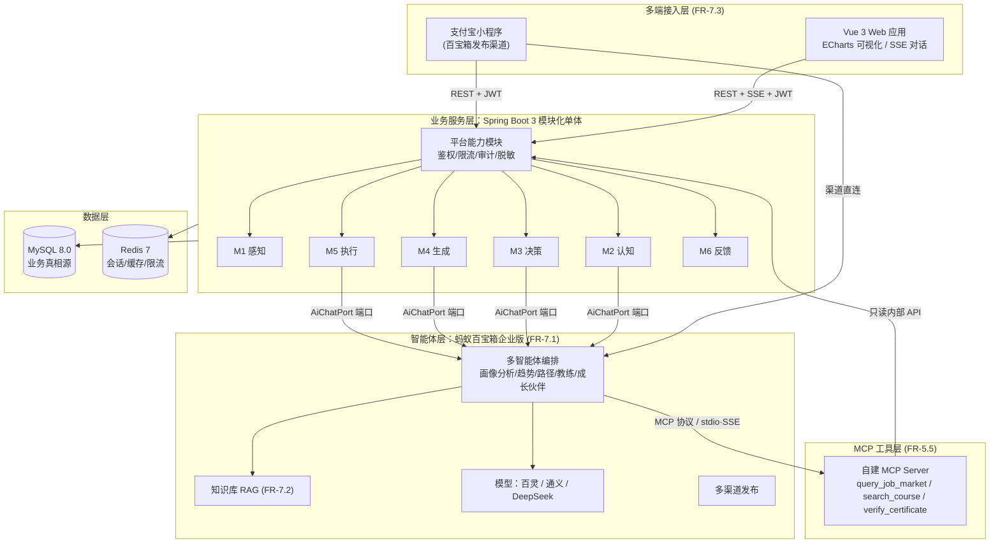

**读图要点（答辩可用）**：
1. **前端只有一个后端入口**（`GW`），不直连百宝箱——保证鉴权、限流、脱敏、审计四件事不可绕过。
2. **百宝箱只出现在「AI 能力」位置**，不出现在「业务数据」位置；小程序端虽然走百宝箱渠道，但**业务状态仍回后端**（D-6）。
3. **MCP Server 是后端的下游而不是上游**：它通过只读内部 API 取数，避免两套数据访问逻辑。

### 2.2 分层职责与禁止事项（**评审时按此表打回 PR**）

| 层 | 必须做 | **禁止做**（越界即架构缺陷） |
|---|---|---|
| 接入层（前端） | 展示、表单校验、图表渲染 | 禁止实现业务规则；禁止直接调百宝箱；禁止在前端算分值 |
| 平台能力层 | 鉴权、限流、审计、脱敏、统一响应、异常兜底 | 禁止写业务语义逻辑（如「路径怎么生成」） |
| 业务模块层 M1–M6 | 领域规则、事务、状态机 | 禁止直接拼接大模型 HTTP 请求（必须走端口）；禁止跨模块直接访问对方 Mapper |
| 端口—适配器层 | 屏蔽百宝箱/模型差异、结构化输出契约 | 禁止把平台返回的原始结构泄漏到领域对象 |
| MCP 工具层 | 只读结构化查询、参数白名单 | 禁止暴露写操作、禁止返回个人隐私数据 |
| 数据层 | 持久化、索引、迁移脚本 | 禁止把业务真相只存在百宝箱侧 |

### 2.3 模块依赖方向（**单向、无环**）

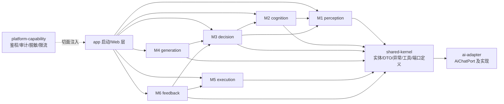

规则：
- `shared-kernel` **只能被依赖，不能依赖任何人**（含 Spring Web，只放纯领域与工具）。
- 业务模块之间**允许通过接口依赖，不允许通过 Mapper 依赖**。
- `ai-adapter` 被业务模块依赖，反向不成立。

---

## 3. 运行时视图与六步闭环数据流

### 3.1 闭环主线（答辩主线，务必按此顺序讲）

| 闭环步骤 | 模块 | 输入 | 处理 | 输出（落库） |
|---|---|---|---|---|
| ① 感知 | M1 | 注册信息、基础信息表单、测评问卷、行为埋点 | 校验 → 加密敏感字段 → 生成能力初始向量 | `user`、`user_profile`、`assessment_record` |
| ② 认知 | M2 | 画像 + 知识图谱 + 知识库 | 趋势推理（带引用）、岗位能力模型抽取、差距分析 | `trend_report`、`gap_analysis` |
| ③ 决策 | M3 | 差距 + 岗位权重 | 雷达计算（版本化）、路径规划、匹配度计算 | `competency_radar`(新版本)、`career_path`/`path_stage` |
| ④ 生成 | M4 | 路径阶段 + 资源库 | 学季→月→周拆解、资源推荐、角色化对话 | `learning_unit`、`chat_message` |
| ⑤ 执行 | M5 | 学习单元 | 任务下发/提醒/打卡、3 个场景模拟、自动评分 | `learning_task`、`simulation_session`、`evaluation` |
| ⑥ 反馈 | M6 | 任务/评分/测评增量 | 成长快照、前后对比、偏离检测、激励文案 | `growth_record`、触发 ③ 重规划 |

**关键闭环约束（写进代码注释即可，但必须存在）**：
> **④ 的输入必须来自 ③ 的持久化结果，⑤ 的评分必须能回写 ③ 的雷达新版本。** 这条链路是「AI 全技术闭环」的物证，也是 D-3（画像动态迭代）的实现方式。

### 3.2 关键时序 1：首次建档（场景 S1，≤5 分钟）

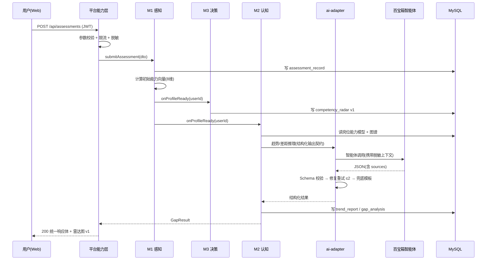

**设计要点**：建档是**同步快**（雷达计算纯本地，不等模型），趋势分析是**可异步/可降级**的（失败则面板显示「暂无趋势」而不阻塞建档）。

### 3.3 关键时序 2：路径生成（SSE + 结构化契约，AD-3）

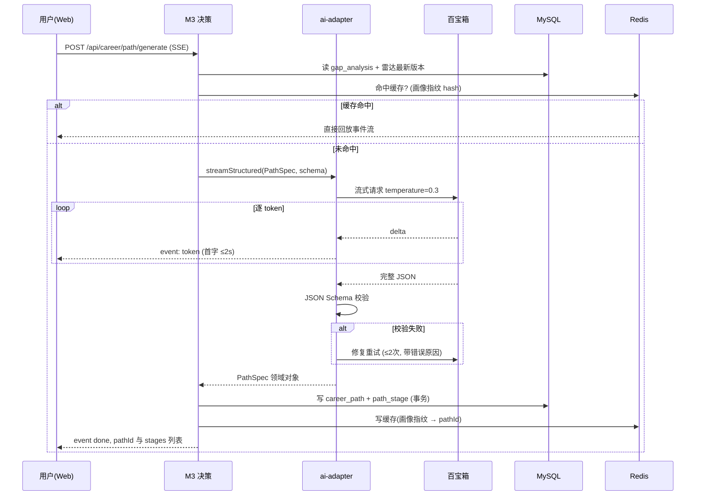

**工程细节（答辩加分项）**：
- 提示词放在 `backend/.../resources/prompts/*.txt`，**纳入 Git 版本化**；`prompt_version` 字段随生成结果落 `ai_generation_log`，可回滚可对比。
- `temperature` 按场景分离：路径 `0.3`、激励文案 `0.8`。
- 校验失败的重试**必须把校验错误回灌给模型**，否则重试无意义。

### 3.4 关键时序 3：模拟训练 → 评分 → 回写画像（D-3 的物证）

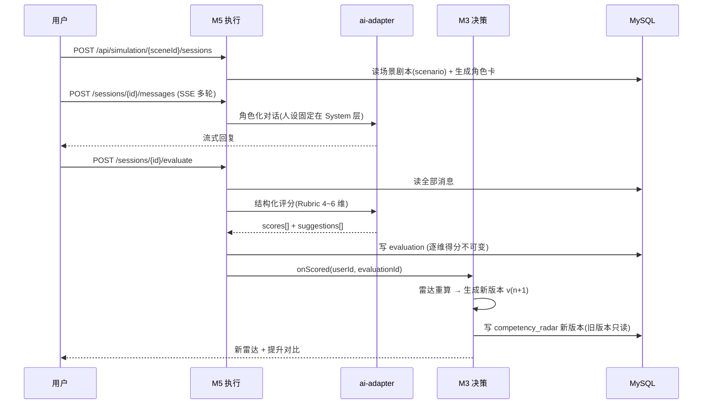

**这是全项目最有说服力的一段演示**：一次训练后雷达图对应维度数值变化，且**两次版本可对比**。

### 3.5 关键时序 4：MCP 工具调用链（FR-5.5）

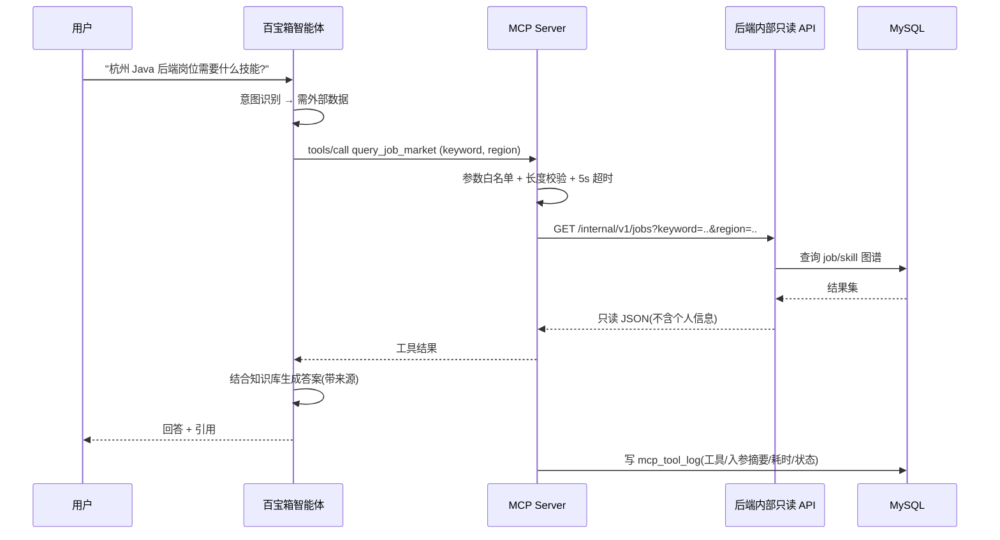

**异常处理三类（专项材料③必须写清）**：超时 → 返回「数据源响应超时，请稍后重试」；非法入参 → 返回字段级错误；上游不可用 → 返回「暂不可用」并**绝不抛栈给模型**。

---

## 4. 后端架构：Maven 多模块（AD-6）

### 4.1 为什么是多模块而不是单模块分包

| 维度 | 单模块分包 | **本方案：Maven 多模块** |
|---|---|---|
| 6 人并行 | 同一 `src` 天天冲突 | 每人独占模块，冲突面收敛 |
| 边界约束 | 靠自觉，容易互相 import | **靠编译器**，越界直接编译失败 |
| Code Review | 一个大 PR 几十文件 | PR 天然按模块切分，评审聚焦 |
| 课程抽测 | 「你负责哪部分」说不清 | 「你负责 M5 模块」指向明确 |
| 风险 | — | 多模块学习成本略高 → **提供 `docs/开发环境搭建.md` 一键脚手架脚本** |

> 兜底策略：若团队 3 人以下或时间紧，可退化为「单模块 + 严格分包」，**包名与本节完全一致**，后续可无痛拆分。

### 4.2 模块清单与归属

| 模块 | 是否 Spring Boot 模块 | 职责 | 对应需求 | 建议负责人 |
|---|---|---|---|---|
| `a02-common` | 否（纯 Java） | 统一响应体、错误码、异常、工具类、枚举、**端口接口定义** | 全局 | 后端 |
| `a02-ai-adapter` | 是 | `AiChatPort` 与实现：百宝箱适配器、Mock 适配器、模型路由、JSON Schema 校验、提示词装载、脱敏管道 | NFR-7, D-1 | AI |
| `a02-m1-perception` | 是 | 用户/权限/基础信息/测评/埋点 | FR-1.1–1.5 | 后端 |
| `a02-m2-cognition` | 是 | 知识图谱、趋势分析、岗位能力模型、差距分析 | FR-2.1–2.4 | AI+后端 |
| `a02-m3-decision` | 是 | 雷达计算与版本化、路径生成/调整、匹配度 | FR-3.1–3.4 | 后端 |
| `a02-m4-generation` | 是 | 学习单元拆解、资源推荐、角色化对话 | FR-4.1–4.4 | AI |
| `a02-m5-execution` | 是 | 任务管理、3 场景模拟、自动评分、平台对接演示 | FR-5.1–5.4 | AI+后端 |
| `a02-m6-feedback` | 是 | 成长快照、对比、偏离检测、激励陪伴 | FR-6.1–6.4 | 前端+后端 |
| `a02-platform` | 是 | 鉴权 JWT、RBAC、限流、审计、脱敏切面、Swagger、全局异常 | NFR-2/3 | 后端 |
| `a02-app` | 是（唯一可执行） | 启动类、配置、Controller/Assembler、SSE 端点 | — | 后端 |

### 4.3 完整体检目录结构（**可直接照建**）

```
team-project/
├─ README.md
├─ docker-compose.yml                 # MySQL 8 + Redis 7 + 可选 mcp-server
├─ .env.example                       # 变量模板（真实 .env 不入库）
├─ .github/
│  ├─ workflows/ci.yml                # 构建 + 测试 + 覆盖率门禁
│  └─ PULL_REQUEST_TEMPLATE.md        # 课程要求：PR 模板
├─ docs/                              # 见需求文档 §5.6
│  ├─ 01-项目概要.md  02-需求与设计.md  03-测试文档.md
│  ├─ 04-架构设计.md（本文）  04b-架构与伦理设计.md
│  ├─ 05-测试与迭代记录.md  AI使用公约.md  AI使用记录.md
│  ├─ 00-开发环境搭建.md  数据库设计.md  接口文档索引.md
│  ├─ 06-企业专项/  01~04
│  ├─ meetings/  PPT/  个人总结/
├─ backend/
│  ├─ pom.xml                         # 聚合 POM：(a) parent=spring-boot-starter-parent
│  ├─ a02-common/
│  │  └─ src/main/java/cn/zjnu/a02/common/
│  │     ├─ api/{ApiResponse,PageResult,ErrorCode,BizException,GlobalErrorCode}.java
│  │     ├─ port/{AiChatPort,KnowledgePort,JobMarketPort,PromptRepository}.java   ← 端口定义
│  │     ├─ domain/{UserId,RadarDimension,ScoreSource,PathStageStatus,...}.java   ← 值对象/枚举
│  │     └─ util/{JsonUtils,MaskingUtils,HashUtils}.java
│  ├─ a02-ai-adapter/
│  │  └─ src/main/java/cn/zjnu/a02/ai/
│  │     ├─ port/impl/{TboxAiAdapter,MockAiAdapter,LocalOllamaAdapter}.java
│  │     ├─ routing/{ModelRouter,AiCallTemplate,RateLimiter,CircuitBreaker}.java
│  │     ├─ schema/{JsonSchemaValidator,StructuredOutputInvoker,RepairLoop}.java
│  │     ├─ prompt/{PromptLoader,PromptVersionRegistry}.java
│  │     ├─ privacy/{PiiRedactor,RedactionRule}.java
│  │     └─ resources/prompts/{persona.txt,trend.txt,path.txt,unit.txt,coach.txt,score.txt,incentive.txt}
│  ├─ a02-platform/
│  │  └─ src/main/java/cn/zjnu/a02/platform/
│  │     ├─ security/{JwtTokenProvider,JwtAuthFilter,RbacEvaluator,SecurityConfig}.java
│  │     ├─ ratelimit/{RedisRateLimiter,RateLimitAspect}.java
│  │     ├─ audit/{AuditLogAspect,AiGenerationLogService}.java
│  │     ├─ privacy/{FieldEncryptor,DesensitizeAspect,DataErasureService}.java
│  │     └─ web/{GlobalExceptionHandler,TraceIdFilter,CorsConfig,OpenApiConfig}.java
│  ├─ a02-m1-perception/...           # 每模块内部统一分包：
│  │     ├─ controller/               # 仅 a02-app 可暴露；模块内 Controller 用 @InternalApi 标注
│  │     ├─ service/  service/impl/
│  │     ├─ mapper/  entity/  dto/  converter/  event/
│  │     └─ resources/mapper/*.xml
│  ├─ a02-m2-cognition/...            # 含 graph/{GraphTraversalService,ClosureTableService}
│  ├─ a02-m3-decision/...             # 含 radar/{RadarCalculator,RadarVersionService}
│  ├─ a02-m4-generation/...  a02-m5-execution/...（含 simulation/{SceneRegistry,RubricScorer}）
│  ├─ a02-m6-feedback/...
│  ├─ a02-app/
│  │  └─ src/main/java/cn/zjnu/a02/app/{A02Application.java, config/, web/}
│  │  └─ src/main/resources/{application.yml, application-dev.yml, application-demo.yml}
│  └─ db/migration/                   # Flyway：V1__init.sql, V2__knowledge_graph.sql ...
├─ frontend/
│  └─ src/{views,components,charts,stores,api,composables,router,styles,types,utils}
└─ mcp-server/
   ├─ pyproject.toml  README.md
   └─ src/a02_mcp/{server.py,tools/,client/backend_client.py,schemas/}
```

**后端包名按六步闭环命名**（`m1-perception` … `m6-feedback`）是低成本高印象分细节：**目录结构本身就在讲赛题要求的闭环**。答辩时打开 IDE 即是物料。

---

## 5. 前端架构

### 5.1 分层与目录

| 目录 | 职责 | 禁止 |
|---|---|---|
| `views/` | 页面级编排（路由对应） | 禁止写复杂业务计算 |
| `components/` | 可复用 UI（含 `AiBadge`、`ScoreCard`、`StageTimeline`） | 禁止直接调 API |
| `charts/` | **ECharts 封装**：`RadarChart`、`GrowthLineChart`、`ProgressRing`、`ActivityHeatmap` | 禁止各页面各自 new echarts |
| `api/` | Axios 实例 + 拦截器 + 按模块的请求函数 + TS 类型 | 禁止在组件里手写 URL |
| `stores/` | Pinia：`userStore`、`profileStore`、`pathStore`、`growthStore`、`chatStore` | 禁止存敏感明文 |
| `composables/` | `useSse()`（流式）、`useChartTheme()`、`usePagination()` | — |
| `types/` | 与后端 DTO 对齐的 TS 接口（**契约单一来源**） | 禁止各页自定义同名字段 |

### 5.2 图表数据契约（**T4 硬指标的关键**）

FR-6.1 要求「雷达图、进度环、成长曲线、热力图」4 类图表，若各自请求接口 → 4 次往返、口径不一致。**设计为后端一次聚合**：

```
GET /api/growth/panel
{
  "code": 0, "message": "success", "traceId": "...",
  "data": {
    "radar":      { "version": 3, "dimensions": [{"key":"PRO_SKILL","label":"专业技能","score":72,"max":100,"source":"ASSESSMENT+SCORE"}], "previousVersion": 2 },
    "progress":   { "totalTasks": 48, "doneTasks": 31, "percent": 64.6, "streakDays": 7 },
    "trend":      { "unit": "week", "points": [{"label":"W1","value":58},{"label":"W2","value":61}] },
    "heatmap":    { "from": "2026-09-01", "to": "2026-12-20", "cells": [{"date":"2026-09-07","value":3}] },
    "disclaimer": "AI 生成内容仅供参考，请结合自身情况核实"
  }
}
```

**约定**：
- 所有图表数据 `value` 归一化到 `0–100`，前端只做展示不做换算。
- `disclaimer` 字段由后端下发 → 满足 NFR-4「界面明示 AI 生成」（前端不硬编码文案，便于统一治理）。
- 版本号随面板返回，前端据此触发雷达动画（FR-3.1「随版本切换动画」）。

### 5.3 流式渲染（SSE）

| 场景 | 事件类型 | 前端处理 |
|---|---|---|
| 路径生成 | `token` / `stage` / `done` / `error` | `useSse()` 累加 `token`，`stage` 到达即渲染时间轴骨架，`done` 后拉详情落 store |
| 模拟对话 | `token` / `role` / `done` | 逐字渲染，保持滚动锚点；固定显示 AI 标识 |

`EventSource` 不能自定义 Header → **采用 `fetch` + `ReadableStream` 手工解析 SSE**，Token 走 `Authorization` 头（不放 URL，避免日志泄漏）。此细节写进 `docs/AI使用记录.md` 与测试文档。

### 5.4 多端适配策略（FR-7.3，避免重复开发）

| 端 | 实现方式 | 复用程度 |
|---|---|---|
| Web（必选） | Vue 3 + Vite 完整功能 | 100% 功能 |
| 支付宝小程序 | **百宝箱渠道发布的智能体对话入口**（不重写业务页面） | 复用 AI 能力，业务数据经后端 API |
| 微信小程序（P2） | 同上，若时间不足明确放弃 | — |

> **设计理由**：赛题要求的是「智能体多端发布」，不是「把 Vue 页面搬进小程序」。用百宝箱渠道承接小程序端，**同时满足 T5 与 R-6 风险控制**，代价最小。

---

## 6. 数据架构

### 6.1 数据主权原则（AD-1 的落地条款）

| 数据类别 | 存放位置 | 理由 |
|---|---|---|
| 用户、画像、路径、任务、评分、日志 | **MySQL（唯一真相源）** | 需要关系查询（两时点对比）、事务、审计 |
| 知识库文档与向量 | 百宝箱知识库（自建侧仅存 `kb_doc_ref` 引用） | 免自建向量库，降低运维成本 |
| 会话上下文/热数据/限流计数 | Redis | 性能，可丢失可重建 |
| 智能体侧 | **不存任何业务状态** | 保证多端一致（D-6）与平台可替换（AD-2） |

### 6.2 概念 ER（深化需求文档 §2.5）

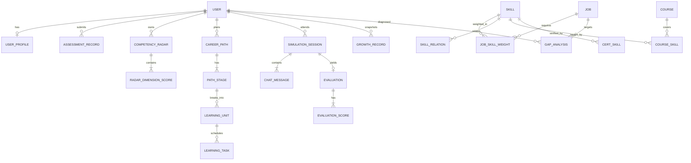

### 6.3 职业知识图谱存储方案（AD-5）

**不引入 Neo4j**，采用「三元组 + 邻接索引 + 闭包表」三件套，覆盖全部查询需求（≤3 跳）：

| 表 | 作用 | 关键列 | 索引 |
|---|---|---|---|
| `kg_entity` | 实体字典（岗位/技能/课程/认证） | `id, type, code, name, attrs_json, status` | `uk(type, code)`、`idx(name)` |
| `kg_relation` | 三元组主体 | `id, subject_id, predicate, object_id, weight, source, updated_at` | `idx(subject, predicate)`、`idx(object, predicate)`、`uk(subject,predicate,object)` |
| `kg_path_closure` | 闭包表（加速多跳） | `ancestor_id, descendant_id, depth, path_weight` | `idx(ancestor)`、`idx(descendant)`、`uk(ancestor,descendant)` |

**查询能力映射**：

| 业务查询 | 实现 |
|---|---|
| 岗位需要哪些技能及权重（FR-2.3） | `kg_relation where subject=job and predicate='REQUIRES'`，`weight` 即能力模型权重 |
| 技能缺口对应哪些课程（FR-4.2） | 反向查 `predicate='TEACHES'` |
| 技能迁移映射（U3 转岗，压缩式路径） | 闭包表 `depth<=2` 查 `RELATED_TO`/`PREREQUISITE_OF` |
| 岗位相似度推荐（FR-3.4 Top-N） | 按共享技能集合 Jaccard 相似度，SQL 聚合 + Redis 缓存 |
| 语义检索（趋势问答） | **交给百宝箱知识库**，不在此表做向量 |

**一致性保障**：图谱数据由 `db/migration` 下的种子 SQL + `docs/知识图谱数据说明.md` 维护（≥3 岗位域、≥100 技能节点，满足 FR-2.1 验收），导入脚本可重跑（幂等 upsert）。

### 6.4 雷达图版本化设计（AD-4，**本项目最易失分点**）

```
competency_radar
 ├─ id, user_id, version(自增 per user), target_job_id
 ├─ triggered_by (枚举: ASSESSMENT | SIMULATION | TASK | MANUAL | REPLAN)
 ├─ formula_version (公式版本号，保证可复算)
 ├─ calc_input_json (快照输入：各来源分值与权重)   ← 可审计的关键
 └─ created_at
radar_dimension_score
 ├─ radar_id, dimension_key(8维), raw_score, weighted_score, source_detail_json
```

**不可变性约束**：雷达版本一旦生成**只读**，重算产生新版本。这样：
- FR-6.2「两时点对比」= 取两个 `radar_id` 做差，无需历史回溯逻辑；
- D-3「画像动态迭代」= 每次 `triggered_by` 落库，可展示「因一次训练新增了 v3」。

### 6.5 雷达分值计算公式（**答辩必答，必须可解释**）

分值 = 各来源加权归一化，**不是模型编的**：

| 维度 key | 维度名 | 参与来源 | 权重分配 |
|---|---|---|---|
| `PRO_SKILL` | 专业技能 | 测评、训练评分 | 测评 0.4 / 训练 0.6 |
| `GEN_ABILITY` | 通用能力 | 测评、训练评分 | 测评 0.5 / 训练 0.5 |
| `INDUSTRY_KNOW` | 行业认知 | 测评、学习任务完成 | 测评 0.6 / 任务 0.4 |
| `PROJECT_EXP` | 项目经验 | 简历抽取标签、任务产出物 | 标签 0.6 / 产出 0.4 |
| `LEARNING_ABILITY` | 学习力 | 任务完成率、连续打卡、时效 | 完成率 0.5 / 打卡 0.3 / 时效 0.2 |
| `COMMUNICATION` | 沟通表达 | 训练评分（沟通类场景） | 训练 1.0 |
| `TOOL_USAGE` | 工具使用 | 测评、训练评分 | 测评 0.5 / 训练 0.5 |
| `COLLABORATION` | 协作意识 | 训练评分（协作类场景） | 训练 1.0 |

```
dimension_score = Σ(source_i.score × weight_i) / Σ(weight_i)        // 缺来源时按剩余权重重归一化
new_value       = old_value × (1 - α) + dimension_score × α          // α=来源类型衰减因子
gap_i           = max(0, job_require_i - radar_i)                     // 差距分析
match_rate      = 100 × Σ(require_i × radar_i/100) / Σ(require_i)     // 岗位匹配度，可解释
```

- **衰减因子 α** 与权重表存 `sys_config`（可配置、可截图给评委看）；
- `formula_version` 随公式变更递增，**旧版本数据仍可复算**；
- 匹配度接口必须回传 `dimensionContributions[]`（每维贡献值），满足 FR-3.4「算法可解释」。

### 6.6 表单清单（≥15 张表要求 → 实际 ~30 张）

| 域 | 表名 | 关键设计点 |
|---|---|---|
| 身份 | `user`, `role`, `permission`, `user_role`, `role_permission`, `user_consent` | BCrypt 口令；`user_consent` 记录隐私授权与撤回（NFR-3） |
| 画像 | `user_profile`, `assessment_record`, `assessment_answer`, `resume_extract_tag` | 手机号 **AES-GCM 加密列**；`resume_extract_tag` 支持用户编辑确认（FR-1.4） |
| 图谱 | `kg_entity`, `kg_relation`, `kg_path_closure`, `job`, `skill`, `course`, `certificate`, `job_skill_weight`, `kb_doc_ref` | 见 §6.3 |
| 决策 | `competency_radar`, `radar_dimension_score`, `career_path`, `path_stage`, `gap_analysis` | 版本化见 §6.4 |
| 生成 | `learning_unit`, `resource_recommendation`, `chat_session`, `chat_message` | `chat_message` 标注 `is_ai_generated`（NFR-4） |
| 执行 | `learning_task`, `task_checkin`, `simulation_scenario`, `simulation_session`, `evaluation`, `evaluation_score`, `rubric_dimension` | `evaluation_score` 不可变；`rubric_dimension` 权重可配 |
| 反馈 | `growth_record`, `growth_snapshot_metric`, `incentive_log`, `deviation_alert` | 快照支持任意两时点对比（FR-6.2） |
| 平台 | `trend_report`, `trend_citation`, `mcp_tool_log`, `ai_generation_log`, `audit_log`, `sys_config`, `data_erasure_request` | 审计与可追溯（NFR-4 责任归属）；`data_erasure_request` 支撑删除接口 |

**通用约定**：主键 `BIGINT` 雪花或自增；所有业务表带 `created_at/updated_at/deleted(逻辑删除)`；`user_id` 建索引；DDL 用 **Flyway 迁移脚本**管理（课程加分：可复现）。

---

## 7. AI 架构（技术实现得分核心）

### 7.1 AI 能力全景

```mermaid
graph TB
    subgraph Biz["业务模块（只依赖端口）"]
        B1["M2 趋势分析"]  B2["M3 路径生成"]  B3["M4 学习拆解"]  B4["M4 角色对话"]  B5["M5 模拟评分"]  B6["M6 激励文案"]
    end
    P["AiChatPort<br/>chat() / stream() / structured()"]
    subgraph Adapter["ai-adapter 实现"]
        R["ModelRouter<br/>模型路由/降级"]
        T["TboxAiAdapter<br/>百宝箱企业版"]
        M["MockAiAdapter<br/>本地模板(离线可用)"]
        O["LocalOllamaAdapter<br/>本地兜底"]
        S["StructuredOutputInvoker<br/>Schema 校验+修复重试+兜底"]
        PR["PiiRedactor<br/>脱敏管道"]
    end
    B1 & B2 & B3 & B4 & B5 & B6 --> P
    P --> R
    R --> T & M & O
    P --> S
    P --> PR
    T --> TB["百宝箱智能体 + 知识库 + MCP"]
```

### 7.2 端口定义与切换策略（AD-2）

```java
public interface AiChatPort {                       // a02-common
    ChatResult chat(ChatRequest req);
    void stream(ChatRequest req, Consumer<Chunk> onChunk);
    <T> T structured(StructuredRequest<T> req);     // 内含 Schema 校验 + 修复重试
}
```

| 开关 | 取值 | 行为 | 用途 |
|---|---|---|---|
| `ai.provider` | `tbox` | 调百宝箱企业版 | 正式演示、答辩（平台适配度加分） |
| | `mock` | 本地模板/规则生成 | **权限未下发时的开发主线**（R-1 闸门） |
| | `ollama` | 本地模型 | 网络故障/配额耗尽时的离线演示（R-9） |
| `ai.fallback.enabled` | true | 主通道失败 → 自动降级 mock 并标记 `degraded=true` | 演示不中断 |
| `ai.ratelimit.*` | 次数/窗口 | Redis 令牌桶，按用户维度 | Token 配额保护（R-2） |

**Mock 适配器的规格要求（关键）**：Mock 不是占位符——它必须返回**结构合法的 JSON**（与真实 Schema 同构），使前端联调、单测、CI 全部可跑。这样「权限未到」不阻塞任何关键路径。

### 7.3 提示工程分层结构（继承需求文档 §3.3.1，补充工程实现）

| 层 | 内容 | 实现位置 | 校验 |
|---|---|---|---|
| System | 人设「灯塔」+ 能力边界 + 禁止编造 + Guard 条款 | `prompts/persona.txt` | 版本号 `persona_v3` |
| Context | 画像/雷达/目标岗位/历史路径（**结构化 JSON 注入，不让模型猜**） | 运行时拼装（`PromptContextBuilder`） | 字段白名单 + 脱敏后注入 |
| Task | 任务指令（含粒度约束：「拆到周，每单元须有产出物与工时」） | `prompts/path.txt` 等 | 单测断言关键约束词存在 |
| Format | 输出格式（JSON Schema） | `schemas/*.json` + `JsonSchemaValidator` | 强校验 |
| Guard | 越权/注入拒绝 | `persona.txt` 尾部 + `InputGuard` | 注入用例集 10 条 |

**提示词仓库约定**：文件名带语义、内容带版本注释头、变更必须走 PR（因为它是「AI 的行为代码」）。答辩时可展示 `git log prompts/` 的演进——这是**提示词版本化的物证**。

### 7.4 结构化输出契约（AD-3，最易翻车处）

```
模型输出 → [1] 提取 JSON 块（容忍被代码块围栏包裹、或前后带说明性文字）
        → [2] JSON Schema 校验（类型/必填/枚举/区间）
        → [3] 失败 → 修复重试 ≤2 次（把校验错误回灌）
        → [4] 仍失败 → 兜底模板（本地规则生成可用但降级的结果）+ 标记 degraded
        → [5] 领域对象映射 + 业务规则二次校验（如「阶段数 ≥4」「每单元有产出物」）
        → [6] 落库，并写 ai_generation_log(prompt_version, model, latency, degraded, retry_count)
```

| 步骤 | 验收指标（对应 D-1） | 测试方式 |
|---|---|---|
| 端到端解析成功率 | ≥95% | 连续生成 20 次，统计 `degraded=false` 比例 |
| 重试有效性 | 修复重试能救回部分失败 | 构造畸形输出单测 |
| 兜底可用性 | 兜底结果仍满足「≥4 阶段」 | 单测 + 演示开关 |

### 7.5 RAG 架构（FR-7.2，专项材料②）

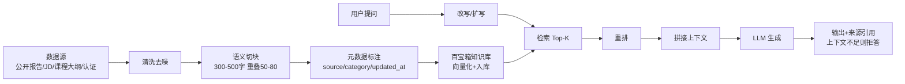

| 环节 | 自建侧职责 | 平台侧职责 |
|---|---|---|
| 数据准备 | 清洗、切块策略、元数据（**评估报告的数据基础**） | 向量化、索引 |
| 检索 | 记录 `kb_doc_ref`、做引用回显 | Top-K 检索、重排 |
| 生成 | 校验引用完整性（无来源不落库） | LLM 生成 |
| 评估 | **构造 50 条测试问答对，算 Recall@K 与准确率** | — |

### 7.6 多智能体编排（FR-7.1，平台适配度加分核心）

| 智能体 | 职责 | 被谁调用 | 对应闭环 |
|---|---|---|---|
| 画像分析师 | 解析信息 → 能力维度分值 | 后端建档流程 | 感知 |
| 趋势研究员 | 知识库推理行业趋势 | M2 趋势接口 | 认知 |
| 路径规划师 | 生成/调整 3–5 年路径 | M3 路径接口 | 决策/生成 |
| 训练教练 | 驱动 3 场景并评分 | M5 模拟接口 | 执行 |
| 成长伙伴（主入口） | 人设对话、陪伴、编排其他智能体 | M4 对话 / M6 激励 | 反馈/陪伴 |

**后端与智能体的职责边界（务必写进专项材料①）**：智能体负责**推理与生成**；后端负责**校验、持久化、权限、兜底**。智能体不直接写库，所有落库都经后端——这是「不让 AI 直接碰生产数据」的架构级安全设计。

---

## 8. MCP Server 架构（FR-5.5，专项材料③）

### 8.1 技术选型与拓扑

| 项 | 决策 | 理由 |
|---|---|---|
| 语言/SDK | Python 3.11 + 官方 `mcp` SDK | 轻量、示例多、与 Java 后端解耦 |
| 传输 | **stdio（本地演示，默认）** + SSE/HTTP（远程部署） | 降低答辩网络风险；远程时供平台调用 |
| 取数方式 | 调**后端只读内部 API**（`/internal/v1/**`，独立 Token） | 避免两套数据逻辑；权限可控可审计 |
| 工具数量 | 3 个（超出赛题最低 2 个要求） | 覆盖岗位/课程/认证三类 |

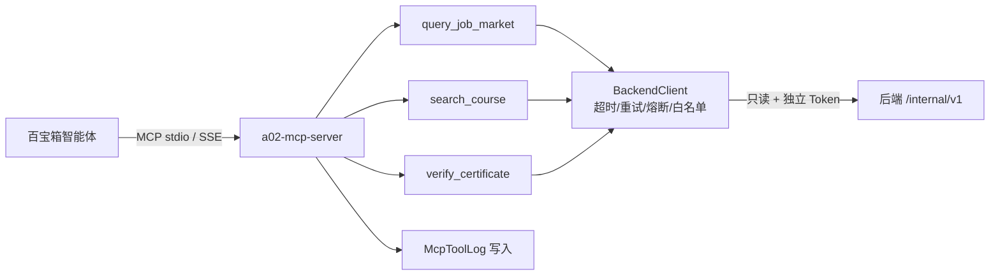

### 8.2 工具契约

| 工具 | 入参（JSON Schema） | 出参 | 约束 |
|---|---|---|---|
| `query_job_market` | `{keyword: string(1-50), region?: string(1-20)}` | `{jobs:[{name,hotScore,topSkills[]}]}` | 只读；超时 5s；空结果返回明确提示 |
| `search_course` | `{skill: string(1-50), level?: enum[BEGINNER,INTERMEDIATE,ADVANCED], limit?: 1-20}` | `{courses:[{title,source,url}]}` | **每条必须带来源** |
| `verify_certificate` | `{cert_name: string(1-50)}` | `{cert:{name,issuer,validity}}` | **绝不返回任何个人证书编号** |

### 8.3 异常与安全（三类异常必须显式处理）

| 异常 | 返回 | 日志 |
|---|---|---|
| 超时（>5s） | `{"error":"UPSTREAM_TIMEOUT","message":"数据源响应超时，请稍后重试"}` | WARN + `mcp_tool_log.status=TIMEOUT` |
| 非法入参 | `{"error":"INVALID_ARGUMENT","fields":[...]}` | WARN + 记录脱敏入参 |
| 上游不可用 | `{"error":"UPSTREAM_UNAVAILABLE",...}` | ERROR + 熔断计数 |

安全基线：① 工具全只读，无写操作；② 入参长度与字符白名单（**防提示注入经工具外溢**，D-5）；③ 不返回用户隐私字段；④ 所有调用落 `mcp_tool_log`（工具名/入参摘要/耗时/状态），支撑 FR-5.5「有调用日志」验收。

---

## 9. 安全、隐私与 AI 伦理架构

### 9.1 纵深防御四层

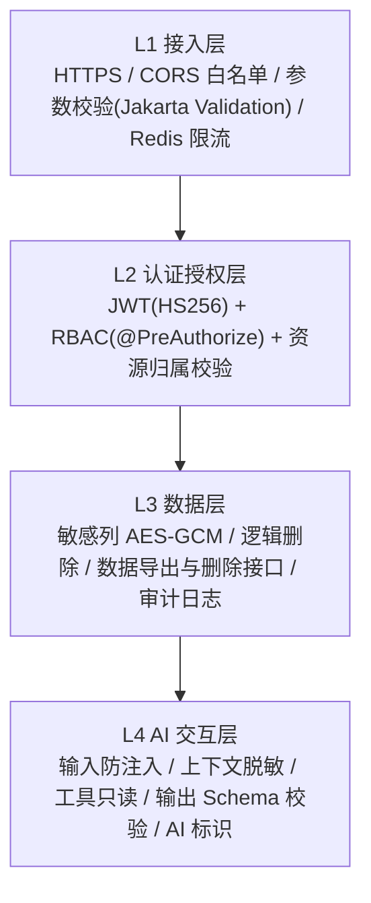

### 9.2 关键实现约定

| 项 | 决策 | 说明 |
|---|---|---|
| 口令 | BCrypt(cost 10) | 课程实验四要求 |
| JWT 存放 | **HttpOnly + Secure + SameSite=Lax Cookie**（不是 localStorage） | 防 XSS 窃取；实验四「前端不裸存明文令牌」 |
| Token 生命周期 | Access 2h + Refresh 7d；登出进 Redis 黑名单 | 可撤销 |
| 敏感字段 | 手机号/邮箱 AES-GCM 加密列 + 独立 KEK 环境变量 | 密钥不入库不入 Git |
| 日志脱敏 | Logback `MaskingPatternLayout` + 自定义 `MaskingUtils` | 姓名/手机/邮箱掩码 |
| 传模型前 | `PiiRedactor` 将姓名→「用户A」、手机→掩码、院校→泛化 | NFR-3「敏感信息不上传公网模型」 |
| 提示注入防护 | 三层：输入白名单 → System Guard → 工具只读 | 10 条注入用例 100% 无害化（课程门槛） |
| 数据权利 | `GET /api/users/me/data`（导出 JSON）、`DELETE /api/users/me/data`（级联删除 + 结果回执） | FR-7.4 |
| 审计 | 登录/改密/导出/删除/生成 均写 `audit_log`、`ai_generation_log` | NFR-4 责任归属与可追溯 |

### 9.3 AI 伦理设计（对应需求文档 §3.6，落到代码）

| 维度 | 代码/界面落点 | 可验证证据 |
|---|---|---|
| 算法偏见 | `persona.txt` 显式禁止性别/年龄/地域/院校差异建议；`BiasTest` 用例集（同能力不同性别/院校对比输出） | 偏见测试报告 |
| 隐私保护 | `FieldEncryptor` + `PiiRedactor` + `DataErasureService` | 代码审查 + 核查清单 |
| 防过度依赖 | 关键建议附 `reasoning[]` 与 `sources[]`；面板下发 `disclaimer`；`PromptGuard` 拒绝医疗/法律类决断 | 界面截图 + 提示词 |
| 透明性 | `<AiBadge>` 组件全局复用；`chat_message.is_ai_generated=true` | 界面截图 |
| 责任归属 | 所有 AI 产出经 Schema 与业务规则双校验；`ai_generation_log` 可追溯 | 日志表样例数据 |
| 合规 | 仅公开数据 + 自构造模拟数据；开源组件在 `docs/开源组件清单.md` 标注来源与协议 | 清单文档 |

> **架构级伦理主张（答辩金句）**：**AI 的输出永远不直接写业务真相源，必须先过校验与审计。** 这不是流程要求，是代码结构保证的——`ai-adapter` 返回的是领域对象，落库发生在业务模块内并带校验。

---

## 10. 接口架构

### 10.1 接口分区

| 分区 | 前缀 | 鉴权 | 用途 |
|---|---|---|---|
| 业务 API | `/api/**` | JWT（用户） | 前端调用 |
| 流式 API | `/api/**/stream` 或带 `Accept: text/event-stream` | JWT | SSE |
| 内部只读 API | `/internal/v1/**` | 独立 Service Token + IP 白名单 | **仅供 MCP Server 调用** |
| 健康/运维 | `/actuator/health`, `/actuator/info` | 无（仅 health） | 部署与探活 |
| 接口文档 | `/swagger-ui/**`, `/v3/api-docs` | 仅 dev/demo 开启 | 课程实验二要求 |

### 10.2 契约约定（课程实验二要求）

```json
{ "code": 0, "message": "success", "data": {}, "traceId": "b7f3c1e2" }
```

| 约定 | 规则 |
|---|---|
| `code` | `0` 成功；业务错误用分段码（`1xxxx` 参数、`2xxxx` 权限、`3xxxx` 业务、`4xxxx` 外部依赖、`5xxxx` AI） |
| HTTP 状态 | 语义化：400 参数、401 未认证、403 越权、404 不存在、429 限流、500 未预期、`503` AI 依赖不可用（可降级） |
| `traceId` | 由 `TraceIdFilter` 生成并透传至日志与响应，便于答辩现场排障 |
| 分页 | `{page,size}` 入参，`{list,total,page,size}` 出参 |
| 时间 | 统一 `ISO-8601` 带时区；前端不做时区猜测 |
| 幂等 | 生成类接口支持 `Idempotency-Key`，防重复点击产生多份路径 |

### 10.3 接口清单（在需求文档 §3.4 基础上补全分组）

| 分组 | 端点 | 需求 | 备注 |
|---|---|---|---|
| 认证 | `POST /api/auth/register`、`/login`、`/refresh`、`/logout` | FR-1.1 | Cookie 下发 |
| 用户 | `GET/PUT /api/users/me/profile`、`GET/DELETE /api/users/me/data`、`POST /api/users/me/consent` | FR-1.2, FR-7.4 | 隐私授权与撤回 |
| 测评 | `POST /api/assessments`、`GET /api/assessments/latest` | FR-1.3 | — |
| 简历 | `POST /api/resume/extract`、`PUT /api/resume/tags` | FR-1.4 | LLM 结构化抽取 + 人工确认 |
| 图谱 | `GET /api/jobs`、`GET /api/jobs/{id}/competency`、`GET /api/skills/{id}/courses` | FR-2.1/2.3 | — |
| 趋势 | `GET /api/trends`、`POST /api/trends/analyze` | FR-2.2 | 输出必带 `sources[]` |
| 差距 | `GET /api/gap?jobId=` | FR-2.4 | 输出 Top-N 排序差距 |
| 画像 | `GET /api/profile/radar?version=`、`GET /api/profile/radar/versions` | FR-3.1 | 版本化与历史列表 |
| 路径 | `POST /api/career/path/generate`（SSE）、`GET /api/career/path`、`PUT /api/career/path/{id}/stages`、`POST /api/career/path/{id}/replan` | FR-3.2/3.3 | 幂等键 + 流式 |
| 匹配 | `GET /api/career/match?jobId=` | FR-3.4 | 回传 `dimensionContributions[]` |
| 学习 | `GET /api/learning/units`、`GET/PATCH /api/learning/tasks[/{id}]`、`POST /api/learning/tasks/{id}/checkin` | FR-4.1, FR-5.1 | — |
| 资源 | `GET /api/resources/recommend?skill=` | FR-4.2 | 每条带来源 |
| 对话 | `POST /api/agent/chat`（SSE）、`GET /api/agent/sessions` | FR-4.4 | 统一代理入口，便于换模型 |
| 模拟 | `GET /api/simulation/scenarios`、`POST /api/simulation/{sceneId}/sessions`、`POST /api/simulation/sessions/{id}/messages`（SSE）、`POST /api/simulation/sessions/{id}/evaluate` | FR-5.2/5.3 | ≥3 场景 |
| 对接演示 | `GET /api/integration/job-market`、`/courses` | FR-5.4 | 附 `complianceNote` 字段说明合规依据 |
| 成长 | `GET /api/growth/panel`、`/compare?a=&b=`、`POST /api/growth/snapshot` | FR-6.1–6.3 | 面板一次聚合 |
| 陪伴 | `GET /api/companion/state`、`POST /api/companion/incentive` | FR-6.4 | 打卡/祝贺/情绪回应 |
| 内部 | `GET /internal/v1/jobs`、`/internal/v1/courses`、`/internal/v1/certs` | FR-5.5 | 仅 MCP Server |

---

## 11. 部署架构

### 11.1 环境拓扑

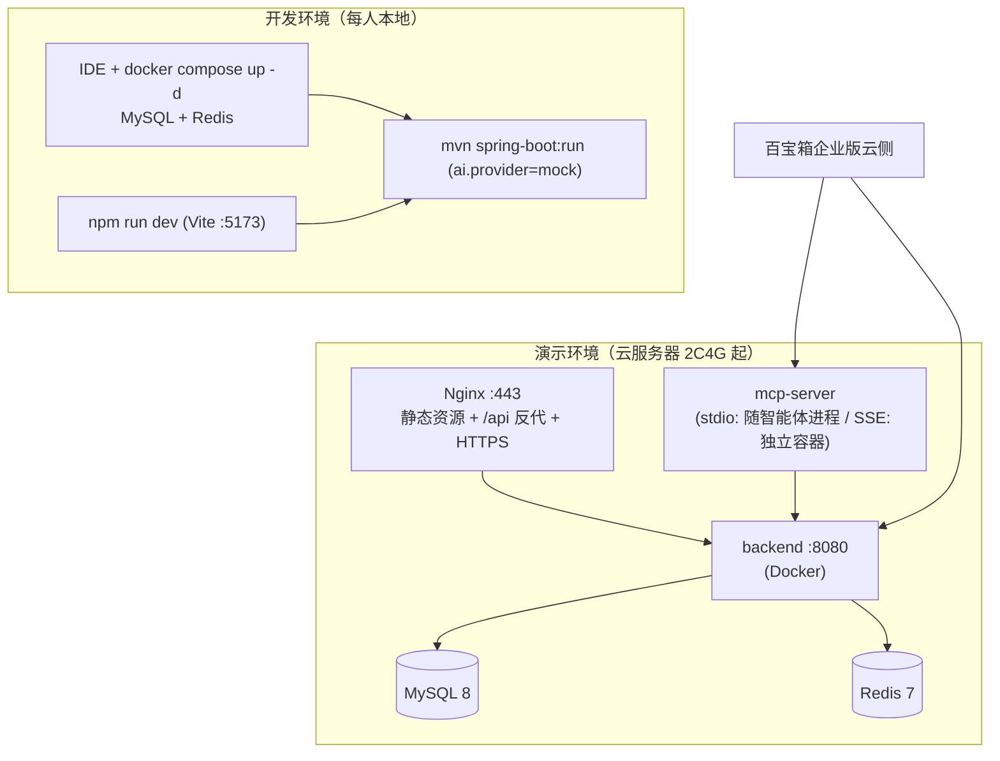

### 11.2 配置与密钥管理

| 配置项 | 存放 | 说明 |
|---|---|---|
| `TBOX_API_KEY` / `TBOX_AGENT_ID` | 环境变量 / 部署平台 Secret | **绝不入库不入 Git** |
| `JWT_SECRET`、`FIELD_AES_KEY` | 环境变量，`.env.example` 只留占位 | 轮换说明写进 `docs/部署说明.md` |
| `INTERNAL_SERVICE_TOKEN` | 环境变量，供 MCP Server 调内部 API | 独立于用户 JWT，权限最小化 |
| Spring Profile | `dev`（Swagger 开、mock 可切）/ `demo`（Swagger 关、限流严）/ `test` | `application-{profile}.yml` |

### 11.3 CI/CD（课程实验三要求）

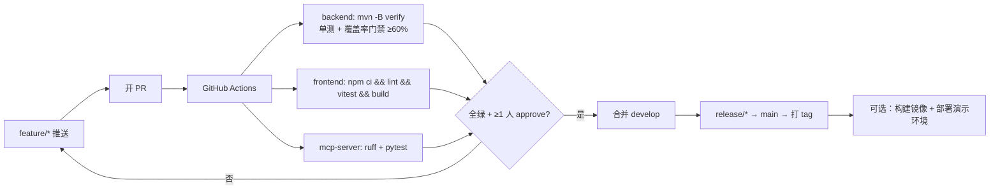

- **分支模型**：`main`（可交付）/ `develop`（集成）/ `feature/*`（开发）/ `hotfix/*`；
- **分支保护**：`develop` 与 `main` 必须 CI 通过 + ≥1 人 Review（课程硬要求），PR 模板要求填写「关联需求编号 + AI 使用说明 + 自测方式」；
- **提交规范**：`feat|fix|docs|test|refactor|chore(scope): 描述`，scope 用模块名（`m3`、`ai`、`web`）→ 便于按模块统计贡献（课程「个人贡献 25%」）。

### 11.4 一键启动（NFR-6）

```bash
# 1. 起中间件
docker compose up -d                     # MySQL + Redis（+ 可选 mcp-server）
# 2. 建表与种子数据（Flyway 自动执行，或手动）
docker compose exec -T mysql < backend/db/migration/V1__init.sql
# 3. 后端（默认 ai.provider=mock，无需百宝箱权限即可开发）
cd backend && mvn -pl a02-app -am spring-boot:run
# 4. 前端
cd frontend && npm ci && npm run dev      # http://localhost:5173
# 5. 切到真实平台（拿到权限后）
AI_PROVIDER=tbox TBOX_API_KEY=xxx mvn -pl a02-app spring-boot:run
```

README 必须写清：前置条件、端口占用、常见错误（MySQL 时区、Redis 密码、Node 版本）。

---

## 12. 架构决策记录（ADR 简表，评审用）

| ID | 决策 | 备选 | 选择理由 | 代价/风险 | 复核时点 |
|---|---|---|---|---|---|
| AD-1 | 三层解耦（平台 AI + 自建业务） | 全平台 / 全自建 | 同时拿赛题与课程分 | 需维护适配层 | M3 |
| AD-2 | AI 能力走端口 + Mock 可切换 | 直接写 HTTP 调用 | 抗 R-1 权限风险，可离线演示 | 适配层开发约 2 人天 | Sprint 0 |
| AD-3 | 结构化输出强校验 + 重试 + 兜底 | 直接 parse | 演示稳定性 | 少量延迟 | Sprint 2 |
| AD-4 | 雷达版本化 + 快照输入落库 | 只存当前值 | 支撑 P1 与 FR-6.2 | 表多一张 | M3 |
| AD-5 | 图谱用 MySQL 三元组 + 闭包表 | Neo4j | 零额外运维，够用 | >3 跳查询吃力（本项目用不到） | M3 |
| AD-6 | Maven 多模块 | 单模块分包 | 6 人并行不打架，边界靠编译器 | 学习成本 | Sprint 0 |
| AD-7 | JWT 走 HttpOnly Cookie | localStorage | 防 XSS | 需处理 CSRF（SameSite + 双提交） | 实验四 |
| AD-8 | MCP 取数走内部只读 API | 直连数据库 | 单一数据逻辑，权限可审计 | 多一跳 | Sprint 3 |
| AD-9 | 小程序端用百宝箱渠道而非重写 | Taro/uni-app | 成本最低且满足 T5 | 小程序端功能弱于 Web | Sprint 4 |

---

## 13. 架构如何映射到课程 5 个实验（**选课得分对齐**）

| 课程实验 | 本架构中的物证 | 检查方式 |
|---|---|---|
| 实验一 Spring Boot/CRUD | `a02-m1-perception` 的 Entity/Mapper/Service/Controller 四层 + `application.yml` 数据源 | 打开模块目录即可见分层 |
| 实验二 前后端分离 + RESTful | §10 契约约定 + `frontend/src/api` 拦截器 + Swagger UI | 联调演示 + `/swagger-ui` |
| 实验三 Git + CI | §11.3 分支模型 + `.github/workflows/ci.yml` + PR 模板 | CI 历史 + PR 记录 |
| 实验四 登录权限 + AI 安全 | `a02-platform/security`（JWT/RBAC）+ §9.2 注入防护 + 注入用例集 | 401/403 用例 + 注入测试报告 |
| 实验五 LLM + RAG | `a02-ai-adapter`（`ask()` 等价物 `AiChatPort`）+ §7.5 RAG 管道 | 智能问答实拍 + 幻觉案例分析 |

> **策略提示（继承需求文档）**：实验五**不要另做一套 Demo**，直接以本架构的 `AiChatPort` 与 RAG 管道完成实验五，一份代码两处交付。

---

## 14. 架构风险与缓解

| 风险 | 对架构的冲击 | 缓解 |
|---|---|---|
| R-1 百宝箱权限未下发 | AI 层空转 | AD-2：`ai.provider=mock` 主线可开发，切换即上线 |
| R-2 Token 配额不足 | 演示中断 | Redis 限流 + 结果缓存（画像指纹）+ 低配额模型开发期 |
| R-3 LLM 输出不稳定 | 入库失败 | AD-3 校验重试兜底 + `formula_version`/`prompt_version` 可回溯 |
| R-4 技术栈不熟 | 模块边界被破坏 | 提供脚手架脚本 + 每个模块一份最小可运行示例（模板方法） |
| R-5 需求蔓延 | 模块膨胀 | P0 冻结；新增需求先过「是否需要新表/新模块」评审 |
| R-6 多端发布超预期 | 工期挤压 | AD-9：Web 必选先做，小程序用渠道发布，微信列 P2 |
| R-9 演示环境故障 | 答辩失败 | 本地离线方案（`ollama`+`mock`+ Docker Compose 全本地） + 备份视频 |
| 多模块过度设计 | 开发变慢 | 3 人以下团队降级为单模块 + 相同分包（§4.1 兜底策略） |

---

## 15. 评审检查清单（架构基线冻结前逐项确认）

- [ ] 4 个 ADR 关键项（AD-1/2/4/6）全员理解，能各自复述
- [ ] 后端模块归属到人，每人能说出「我的模块边界与依赖方向」
- [ ] 数据库 `V1__init.sql` 可执行，表数 ≥15，`competency_radar` 含 `version` 与 `calc_input_json`
- [ ] 雷达公式（§6.5）经产品/后端共同确认，且能解释每个维度来源
- [ ] 接口清单（§10.3）与前端页面一一对齐，无「孤儿接口」
- [ ] `ai.provider=mock` 下全流程可跑通（不依赖百宝箱权限）
- [ ] `.github/workflows/ci.yml` 至少跑通一次（后端 verify + 前端 build）
- [ ] 隐私字段清单确认（哪些加密、哪些脱敏、哪些不采集）
- [ ] MCP 三个工具的 Schema 与异常返回约定确认
- [ ] README 一键启动脚本在**一台干净机器**上验证过

---

## 16. 下一步行动

| # | 行动 | 负责人 | 交付 | 期限 |
|---|---|---|---|---|
| 1 | 架构评审会，逐项过 §15 清单 | PM+全员 | 评审记录进 `docs/meetings/` | 本周 |
| 2 | 按 §4.3 创建仓库骨架 + 多模块 POM + 空壳工程 | 后端 | CI 首次全绿 | Sprint 0 |
| 3 | 编写 `V1__init.sql` 与 `docs/数据库设计.md` | 后端 | 可执行 DDL | Sprint 0 |
| 4 | 落地 `AiChatPort` + `MockAiAdapter`（含 Schema 校验骨架） | AI | 单测通过 | Sprint 0 |
| 5 | 前端脚手架 + 4 类图表组件空壳 + SSE composable | 前端 | 可渲染假数据 | Sprint 0 |
| 6 | MCP Server 骨架 + 1 个 Hello 工具跑通 | AI | 调用日志落库 | Sprint 0 |
| 7 | 冻结接口清单 v1，生成 TS 类型 | 后端+前端 | `docs/接口文档索引.md` | Sprint 0 |

---

### 文档修订记录

| 版本 | 日期 | 修订人 | 说明 |
|---|---|---|---|
| v1.0 | 2026-09-18 | — | 首版：ADR、模块划分、数据/AI/MCP/安全/部署架构、与课程实验映射 |
