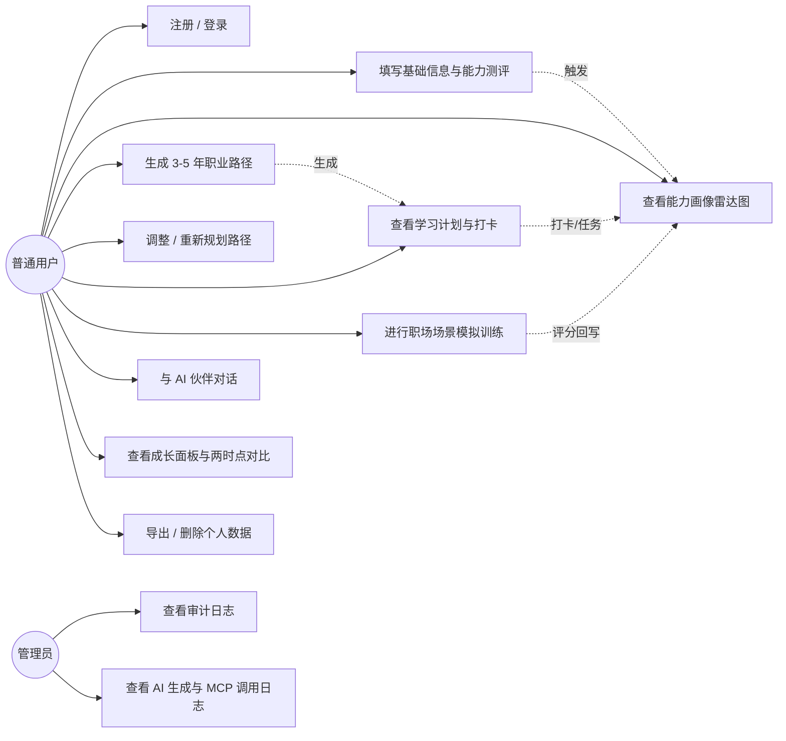
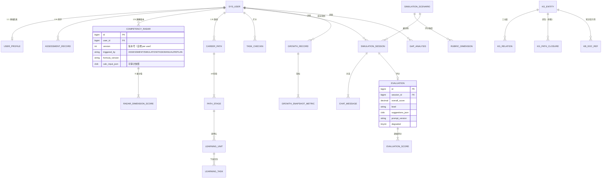
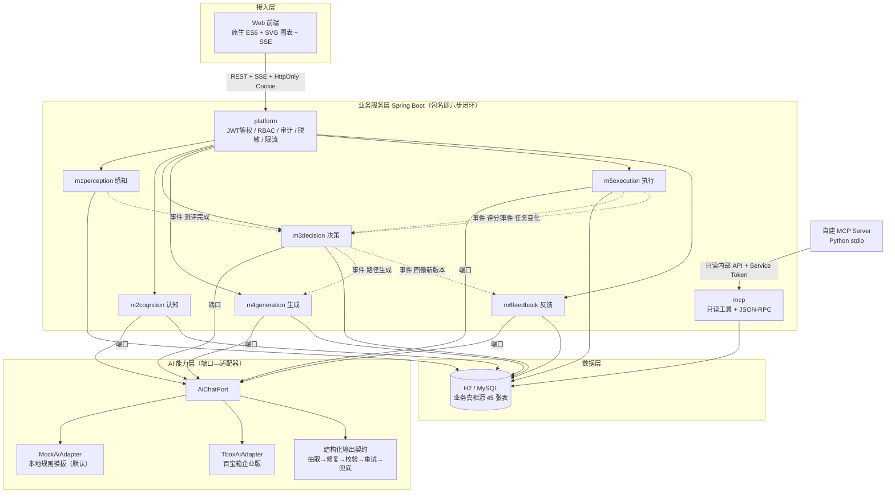
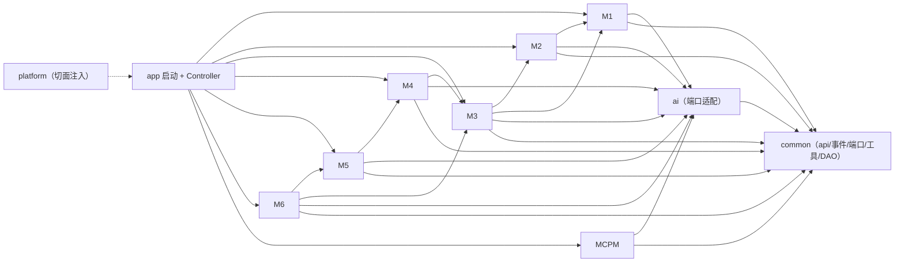

# 02 需求分析与设计文档

> 课程交付物②（对应《团队规范项目实训》第三部分 §4「需求分析与设计文档」）
> 要求：用例 / 用户故事、功能清单、ER / 架构图、接口说明

---

## 一、用户角色与用例

### 1.1 角色

| 角色 | 说明 | 系统权限 |
|---|---|---|
| 游客 | 未登录 | 仅注册 / 登录 / 健康检查 |
| **普通用户（USER）** | 学生、职场新人、转岗人群 | 本人的画像、路径、任务、训练、对话 |
| **管理员（ADMIN）** | 院校就业中心 / 系统运营 | 普通用户全部权限 + 审计日志查看 |

> 权限通过 JWT 载荷中的 `role` 声明，由 `AuthInterceptor` + `@RequireRole` 校验，
> 越权返回 403（业务码 20003），未登录返回 401（业务码 20001）。

### 1.2 用例图



**关键闭环在用例图中的体现**：UC2 / UC6 / UC7 都会**回写 UC3**（画像重算），
这就是赛题 P1「动态职业画像」的落地方式。

---

## 二、用户故事（Epic → Story，含验收条件）

| Epic | 用户故事 | 验收（Given-When-Then） | 实现状态 |
|---|---|---|---|
| **E1 建档** | 作为学生，我想快速录入信息并得到初始画像 | Given 已注册，When 提交基础信息 + 测评，Then 生成雷达 v1 且差距分析可见 | ✅ |
| **E2 路径** | 作为学生，我想得到可执行的 3–5 年路径 | Given 已建档，When 点击生成，Then 输出 ≥4 阶段，每阶段有目标 / 技能 / **可验证产出物** | ✅ |
| **E3 调整** | 作为学生，我想按实际情况改路径 | Given 已有路径，When 修改阶段目标，Then 保存成功且刷新后仍在 | ✅ |
| **E4 训练** | 作为新人，我想练习职场沟通 | Given 进入跨岗位沟通场景，When 完成 ≥3 轮对话，Then 得到逐维评分 + 改进建议 | ✅ |
| **E5 复盘** | 作为学生，我想看到自己的进步 | Given 有 ≥2 个画像版本，When 选择两版本对比，Then 展示逐维增减 | ✅ |
| **E6 陪伴** | 作为学生，我想被提醒和鼓励 | Given 连续打卡 ≥3 天，When 打开成长面板，Then 显示含**具体事实**的鼓励语与下一步动作 | ✅ |
| **E7 趋势** | 作为转岗者，我想知道目标岗位要什么 | When 生成趋势分析，Then 输出带**来源引用**，无来源不外答 | ✅ |
| **E8 隐私** | 作为用户，我想控制自己的数据 | When 点击导出 / 删除，Then 得到 JSON 副本 / 删除回执 | ✅ |
| **E9 治理** | 作为管理员，我想追溯 AI 产出 | When 打开平台页，Then 可看到每次生成用的提示词版本、重试次数、是否降级 | ✅ |
| **E10 训练场景** | 作为学生，我想练多个场景 | Then 系统提供 **3 个**场景（远程协作 / AI 辅助办公 / 跨岗位沟通） | ✅ |

---

## 三、功能清单

> 编号规则：`FR-模块序号`，与 `docs/04-架构设计.md` 的六步闭环一一对应。

### M1 感知层（用户状态采集）

| 编号 | 功能 | 优先级 | 状态 | 实现位置 |
|---|---|---|---|---|
| FR-1.1 | 注册 / 登录 / JWT 鉴权 / RBAC | P0 | ✅ | `m1perception/PerceptionService` + `platform/security` |
| FR-1.2 | 基础信息录入（学历/专业/目标岗位/每周学时…） | P0 | ✅ | 同上 + `UserProfileMapper` |
| FR-1.3 | 能力测评问卷（8 维 × 2 题，5 级量表）→ 初始能力向量 | P0 | ✅ | `PerceptionService.submitAssessment` |
| FR-1.4 | 简历 / 项目经历文本 → LLM 结构化抽取技能标签（**需人工确认**） | P1 | ✅ | `ai` 的 resume 场景 |
| FR-1.5 | 行为埋点（任务完成、测评提交、登录） | P0 | ✅ | `behavior_event` 表 |

### M2 认知层（职业趋势分析）

| 编号 | 功能 | 优先级 | 状态 |
|---|---|---|---|
| FR-2.1 | 职业知识图谱（岗位—技能—课程—认证三元组） | P0 | ✅ **154 节点 / 143 关系 / 4 岗位域 / 124 技能** |
| FR-2.2 | 行业趋势智能分析（**输出必带来源**） | P0 | ✅ |
| FR-2.3 | 岗位能力模型（技能 + 权重 1–5） | P0 | ✅ |
| FR-2.4 | 能力差距分析（Top-N，按 权重×差距 排序） | P0 | ✅ |
| — | 技能迁移映射（转岗压缩式路径，基于闭包表） | P1 | ✅ 额外实现 |

### M3 决策层（路径规划）

| 编号 | 功能 | 优先级 | 状态 |
|---|---|---|---|
| FR-3.1 | **动态职业画像 + 竞争力雷达图**（8 维，版本化，历史可对比） | P0 | ✅ |
| FR-3.2 | **3–5 年职业路径生成**（≥4 阶段，每阶段含目标/技能/产出物） | P0 | ✅ SSE 流式 |
| FR-3.3 | 路径细化与调整（增删改阶段 / 重新规划） | P0 | ✅ |
| FR-3.4 | 岗位匹配度（**逐项贡献值可解释**） | P0 | ✅ |

### M4 生成层（学习内容与建议）

| 编号 | 功能 | 优先级 | 状态 |
|---|---|---|---|
| FR-4.1 | 学习路径拆解（季度→月→**周单元**，含产出物与工时） | P0 | ✅ 自动拆解 30 个单元 |
| FR-4.2 | 学习资源推荐（从知识图谱取课程，**每条带来源**） | P0 | ✅ |
| FR-4.3 | 学习内容生成（知识点/练习题） | P1 | ⏳ 未实现 |
| FR-4.4 | **角色化自然语言对话**（人设 + 上下文记忆 + 情绪共情） | P0 | ✅ SSE 流式 |

### M5 执行层（任务提醒与资源对接）

| 编号 | 功能 | 优先级 | 状态 |
|---|---|---|---|
| FR-5.1 | 学习任务管理（待办 / 进行中 / 完成 + 连续打卡） | P0 | ✅ |
| FR-5.2 | **职场场景模拟训练 ≥3 个** | P0 | ✅ 3 个，各 5 维 Rubric |
| FR-5.3 | 模拟训练自动评分 + 改进建议 + **回写能力画像** | P0 | ✅ |
| FR-5.4 | 学习 / 招聘平台 API 对接演示 | P1 | ✅ 以 MCP 工具形式实现 |
| FR-5.5 | **MCP 协议对接**（自建 Server，≥2 个只读工具，有调用日志） | P0 | ✅ 3 个工具 |

### M6 反馈层（效果评估与动态调整）

| 编号 | 功能 | 优先级 | 状态 |
|---|---|---|---|
| FR-6.1 | 成长轨迹面板（雷达 / 进度环 / 成长曲线 / 热力图 **一次聚合**） | P0 | ✅ |
| FR-6.2 | 阶段效果评估（任意两时点画像对比） | P0 | ✅ |
| FR-6.3 | 动态调整建议（偏离检测，触发条件可复现） | P0 | ✅ |
| FR-6.4 | **情感陪伴与目标监督**（里程碑祝贺、连击、情绪感知回应） | P1 | ✅ |

### M7 平台与合规层

| 编号 | 功能 | 优先级 | 状态 |
|---|---|---|---|
| FR-7.1 | 智能体编排与配置（可切换百宝箱 / Mock） | P0 | ✅ 端口化，Mock 已跑通 |
| FR-7.2 | 知识库构建与引用（无来源不外答） | P0 | ⚠ 数据侧完成，召回评估待平台就绪 |
| FR-7.3 | 多端发布（Web 必选 + 小程序） | P0 | ⚠ Web 完成；小程序需平台权限 |
| FR-7.4 | 数据隐私（加密列、脱敏、导出、删除） | P0 | ✅ |
| FR-7.5 | AI 伦理（AI 标识、可解释、防过度依赖） | P0 | ✅ |

**优先级统计**：P0 共 26 项，**已实现 24 项**；P1 共 5 项，已实现 4 项。

---

## 四、数据库设计

### 4.1 ER 图（核心实体）



> **最关键的一张表是 `competency_radar`**：它的 `version` 字段是「画像动态迭代」（P1）
> 与「两时点对比」（FR-6.2）的数据基础；`calc_input_json` 保存了本次计算的全部输入与权重，
> 保证任何历史版本都能被复算与审计。

### 4.2 表清单（45 张，按域分组）

| 域 | 表 | 设计要点 |
|---|---|---|
| **身份** (6) | `sys_user` `sys_role` `sys_permission` `sys_user_role` `sys_role_permission` `user_consent` | BCrypt 口令；`user_consent` 记录隐私授权与撤回 |
| **画像** (5) | `user_profile` `assessment_record` `assessment_answer` `resume_extract_tag` `behavior_event` | 手机号/邮箱 **AES-GCM 加密列**；抽取标签支持用户确认 |
| **图谱** (7) | `kg_entity` `kg_relation` `kg_path_closure` `job_skill_weight` `course_skill` `cert_skill` `kb_doc_ref` | 三元组 + 邻接索引 + 闭包表，覆盖 ≤3 跳查询 |
| **决策** (5) | `competency_radar` `radar_dimension_score` `career_path` `path_stage` `gap_analysis` | 雷达**版本化 + 快照输入落库** |
| **生成** (4) | `learning_unit` `resource_recommendation` `chat_session` `chat_message` | 消息标注 `is_ai_generated`（AI 标识） |
| **执行** (7) | `learning_task` `task_checkin` `simulation_scenario` `rubric_dimension` `simulation_session` `evaluation` `evaluation_score` | 逐维得分不可变；Rubric 权重可配 |
| **反馈** (4) | `growth_record` `growth_snapshot_metric` `incentive_log` `deviation_alert` | 快照支持任意两时点对比 |
| **平台** (7) | `trend_report` `trend_citation` `mcp_tool_log` `ai_generation_log` `audit_log` `sys_config` `data_erasure_request` | 审计与可追溯 |

**通用约定**：主键 `BIGINT` 自增；业务表带 `created_at`；逻辑删除用 `deleted`；
`user_id` 建索引；DDL 集中在 `src/main/resources/db/schema.sql`（可重跑）。

### 4.3 为什么不用 Neo4j

知识图谱采用「**三元组表 + 邻接索引 + 闭包表**」，而不是引入图数据库：
本项目最长查询路径 ≤3 跳（技能迁移映射），MySQL 完全够用，
而引入 Neo4j 会额外增加一个运维组件（答辩环境风险 +1）。
闭包表在应用启动时按需重算（幂等），当前写入 **62 行**多跳关系。

---

## 五、架构设计

### 5.1 分层架构



### 5.2 模块依赖方向（单向）



**规则**：`common` 只能被依赖；业务模块之间通过**接口与领域事件**通信，
不直接访问对方 Mapper（跨模块读取统一走 `common.port` 下的端口，如 `RadarQueryPort`）。

### 5.3 六步闭环的数据流

| 步骤 | 模块 | 输入 | 处理 | 落库 |
|---|---|---|---|---|
| ① 感知 | M1 | 注册、基础信息、测评、埋点 | 校验 → 生成能力向量 | `sys_user` `user_profile` `assessment_record` |
| ② 认知 | M2 | 画像 + 知识图谱 + 知识库 | 趋势推理（带来源）、能力模型、差距分析 | `trend_report` `gap_analysis` |
| ③ 决策 | M3 | 差距 + 岗位权重 | 雷达计算（版本化）、路径规划、匹配度 | `competency_radar`(新版本) `career_path` |
| ④ 生成 | M4 | 路径阶段 + 资源库 | 学季→月→周拆解、资源推荐、角色对话 | `learning_unit` `chat_message` |
| ⑤ 执行 | M5 | 学习单元 | 任务下发/打卡、3 场景模拟、自动评分 | `learning_task` `evaluation` |
| ⑥ 反馈 | M6 | 任务/评分/测评增量 | 成长快照、前后对比、偏离检测、激励 | `growth_record` `deviation_alert` |

> **闭环约束**：④ 的输入必须来自 ③ 的持久化结果；⑤ 的评分必须能回写 ③ 的新版本。
> 这条链路由领域事件（`common.event.Events`）显式接线，是「AI 全技术闭环」的物证。

---

## 六、接口说明

### 6.1 契约约定

```json
{ "code": 0, "message": "success", "data": {}, "traceId": "b7f3c1e2" }
```

| 约定 | 规则 |
|---|---|
| `code` | `0` 成功；分段码：`1xxxx` 参数、`2xxxx` 权限、`3xxxx` 业务、`4xxxx` 外部依赖、`5xxxx` AI |
| HTTP 状态 | 400 参数 / 401 未认证 / 403 越权 / 404 不存在 / 429 限流 / 500 未预期 / 503 依赖不可用 |
| `traceId` | 由 `TraceIdFilter` 生成，写入日志与响应头，便于排障 |
| 鉴权 | Web 端令牌走 **HttpOnly + SameSite=Lax Cookie**；小程序/调试走 `Authorization: Bearer` |
| 流式 | SSE（`text/event-stream`），事件名 `progress` / `token` / `done` / `error` |

### 6.2 接口清单（81 个端点）

**认证（4）**

| 方法 | 路径 | 说明 |
|---|---|---|
| POST | `/api/auth/register` | 注册，下发 Cookie + token |
| POST | `/api/auth/login` | 登录 |
| POST | `/api/auth/logout` | 登出（清除 Cookie） |
| GET | `/api/health` | 健康检查（免鉴权） |

**M1 感知（13）**

| 方法 | 路径 | 说明 |
|---|---|---|
| GET | `/api/users/me` | 当前用户 + 建档状态 |
| GET / PUT | `/api/users/me/profile` | 查询 / 更新基础信息 |
| GET / POST | `/api/users/me/consent` | 隐私授权查询 / 提交、撤回 |
| GET / DELETE | `/api/users/me/data` | 导出 / 级联删除个人数据 |
| GET | `/api/profile/dimensions` | 8 个能力维度定义 |
| GET | `/api/assessments/questions` | 测评题库（16 题） |
| POST | `/api/assessments` | 提交测评 → 生成能力向量并触发画像 v1 |
| GET | `/api/assessments/latest` | 最近一次测评 |
| POST | `/api/resume/extract` | LLM 抽取技能标签 |
| GET / PUT | `/api/resume/tags` | 查询 / 确认标签 |

**M2 认知（9）**

| 方法 | 路径 | 说明 |
|---|---|---|
| GET | `/api/jobs` | 岗位列表 |
| GET | `/api/jobs/{id}/competency` | 岗位能力模型（技能 + 权重） |
| GET | `/api/skills/{id}/courses` | 技能对应课程 |
| GET | `/api/kg/stats` | 图谱规模统计 |
| GET | `/api/kg/migration?from=&to=` | 技能迁移映射 |
| GET | `/api/certs` | 认证清单 |
| GET | `/api/gap` `/api/gap/latest` | 差距分析 / 最近一次 |
| POST | `/api/trends/analyze` | 趋势分析（**输出带来源**） |
| GET | `/api/trends` | 历史趋势报告 |

**M3 决策（10）**

| 方法 | 路径 | 说明 |
|---|---|---|
| GET | `/api/profile/radar?version=` | 雷达数据（支持版本参数） |
| GET | `/api/profile/radar/versions` | 版本历史 |
| GET | `/api/profile/radar/compare?a=&b=` | 两版本对比 |
| GET | `/api/profile/radar/formula` | 公式与权重说明 |
| POST | `/api/profile/radar/recalculate` | 手动重算画像 |
| POST | `/api/career/path/generate` | **SSE 流式**生成 3–5 年路径 |
| GET | `/api/career/path` `/history` | 当前 / 历史路径 |
| PUT | `/api/career/path/stages/{id}` | 调整阶段 |
| POST | `/api/career/path/{pathId}/stages` | 新增阶段 |
| DELETE | `/api/career/path/stages/{id}` | 删除阶段（少于 4 个时拒绝） |
| POST | `/api/career/path/replan` | 重新规划 |
| GET | `/api/career/match` | 岗位匹配度（含逐项贡献值） |

**M4 生成（7）**

| 方法 | 路径 | 说明 |
|---|---|---|
| GET | `/api/learning/units` | 学习单元列表 |
| POST | `/api/learning/stages/{id}/units` | 重新拆解某阶段单元 |
| GET | `/api/resources/recommend?skill=` | 资源推荐（带来源） |
| GET | `/api/kb/docs` | 知识库引用 |
| POST | `/api/agent/chat` | **SSE** AI 伙伴对话 |
| GET | `/api/agent/sessions` `/{id}/messages` | 会话 / 消息 |
| GET | `/api/agent/context` | 注入给模型的结构化上下文（答辩用） |

**M5 执行（13）**

| 方法 | 路径 | 说明 |
|---|---|---|
| GET | `/api/learning/tasks?status=` | 任务列表 |
| POST | `/api/learning/tasks/generate` | 从学习单元生成任务 |
| PATCH | `/api/learning/tasks/{id}` | 更新任务状态 |
| POST | `/api/learning/checkin` | 每日打卡 |
| GET | `/api/learning/stats` `/heatmap` | 统计 / 热力图 |
| GET | `/api/simulation/scenarios` | 3 个训练场景 + Rubric |
| POST | `/api/simulation/{scenarioId}/sessions` | 开始训练 |
| POST | `/api/simulation/sessions/{id}/messages` | **SSE** 角色扮演对话 |
| POST | `/api/simulation/sessions/{id}/evaluate` | 生成评分并**回写画像** |
| GET | `/api/simulation/sessions` `/{id}` | 会话列表 / 详情 |

**M6 反馈（8）**

| 方法 | 路径 | 说明 |
|---|---|---|
| GET | `/api/growth/panel` | **一次聚合 4 类图表数据** |
| GET | `/api/growth/compare?a=&b=` | 两时点对比 |
| GET | `/api/growth/snapshots` | 成长快照 |
| POST | `/api/growth/alerts/{id}/resolve` | 已知悉偏离提示 |
| GET | `/api/growth/formula` | 公式说明 |
| GET | `/api/companion/state` | 陪伴状态（打卡/里程碑/激励） |
| GET | `/api/companion/incentives` | 激励历史 |
| POST | `/api/companion/emotion` | 情绪标签判定 |

**MCP 与治理（16）**

| 方法 | 路径 | 说明 |
|---|---|---|
| POST | `/mcp` | JSON-RPC 2.0（initialize / tools/list / tools/call） |
| GET | `/api/mcp/tools` `logs` `stats` | 工具清单 / 调用日志 / 统计 |
| POST | `/api/mcp/call` | 演示界面调用工具 |
| GET | `/internal/v1/jobs` `courses` `certs` | **只读内部 API**（Service Token，供 MCP Server） |
| GET | `/api/platform/ai-status` | AI 通道状态（提供方 / 降级策略） |
| GET | `/api/platform/ai-logs` | AI 生成日志（提示词版本 / 重试 / 降级） |
| GET | `/api/platform/prompts` | 提示词仓库与版本 |
| GET | `/api/platform/audit-logs` | 审计日志（**仅 ADMIN**） |
| GET | `/api/platform/config` `privacy` `overview` | 配置 / 隐私措施 / 闭环总览 |

---

## 七、核心算法说明（答辩必答）

### 7.1 能力雷达分值怎么来的

```
raw   = Σ(来源分值 × 来源权重) / Σ(来源权重)      // 缺失来源按剩余权重重归一化
final = old × (1 − α) + raw × α                  // α 为衰减因子，存 sys_config（默认 0.35）
```

| 维度 | 参与来源与权重 |
|---|---|
| 专业技能 | 测评 0.4 / 训练评分 0.6 |
| 通用能力 | 测评 0.5 / 训练评分 0.5 |
| 行业认知 | 测评 0.6 / 学习任务 0.4 |
| 项目经验 | 简历标签 0.6 / 任务产出 0.4 |
| 学习力 | 完成率 0.5 / 连续打卡 0.3 / 按时完成 0.2 |
| 沟通表达 | 训练评分 1.0 |
| 工具使用 | 测评 0.5 / 训练评分 0.5 |
| 协作意识 | 训练评分 1.0 |

**关键点**：分值**不是模型编的**；每次计算的输入与权重写入 `calc_input_json`，可复算、可审计，
权重与 α 存 `sys_config` 可现场修改验证。

### 7.2 岗位匹配度怎么算

```
require_i      = 技能权重(1–5) × 20
capability_i   = 该技能映射能力维度的雷达分值
contribution_i = require_i × capability_i / 100
matchRate      = 100 × Σ contribution_i / Σ require_i
```

接口**回传逐项贡献值**（`topContributions` / `dimensionContributions`），
因此「为什么是 67.5%」可以逐条拆给评委看。技能→维度映射规则集中在
`CognitionService.SkillDimensionMapper`，差距分析与匹配度共用同一映射，口径一致。

### 7.3 结构化输出契约（最易翻车处的兜底）

```
模型输出 → [1] 提取 JSON 块（容忍代码块围栏与前后说明文字）
       → [2] 本地修复（去尾逗号、去注释）
       → [3] Schema 校验（必填 / 非空数组 / 数值区间）
       → [4] 业务规则二次校验（阶段数 ≥4、每阶段须有产出物）
       → [5] 失败则把校验错误回灌重试（≤2 次）
       → [6] 仍失败则用兜底模板并标记 degraded
       → [7] 领域对象映射后落库，并写 ai_generation_log
```

演示时点「制造一次校验失败」即可看到第 5 步真实发生（页面显示重试次数 1）。

---

## 八、接口与页面对照（无「孤儿接口」）

| 页面 | 主要调用的接口 |
|---|---|
| ① 建档与测评 | `/api/jobs` `/api/users/me/profile` `/api/assessments/*` `/api/resume/*` |
| ② 成长面板 | `/api/growth/panel` `/api/growth/compare` `/api/profile/radar/*` `/api/companion/state` |
| ③ 职业路径 | `/api/career/path/*` `/api/career/match` `/api/learning/stages/{id}/units` |
| ④ 学习计划 | `/api/learning/tasks` `/api/learning/units` `/api/learning/checkin` `/api/learning/stats` |
| ⑤ 职场模拟训练 | `/api/simulation/*` |
| ⑥ AI 伙伴对话 | `/api/agent/chat` `/api/agent/context` `/api/agent/sessions` |
| ⑦ 职业知识图谱 | `/api/jobs` `/api/kg/*` `/api/gap` `/api/trends/*` `/api/certs` `/api/kb/docs` |
| ⑧ 平台与 AI 伦理 | `/api/platform/*` `/api/mcp/*` `/api/users/me/data` |

> 已用 `tools/api-contract.mjs` 对上述接口逐条调用验证（53 项，全部通过），
> 可确保交付版本不存在「文档有、代码无」的孤儿接口。
