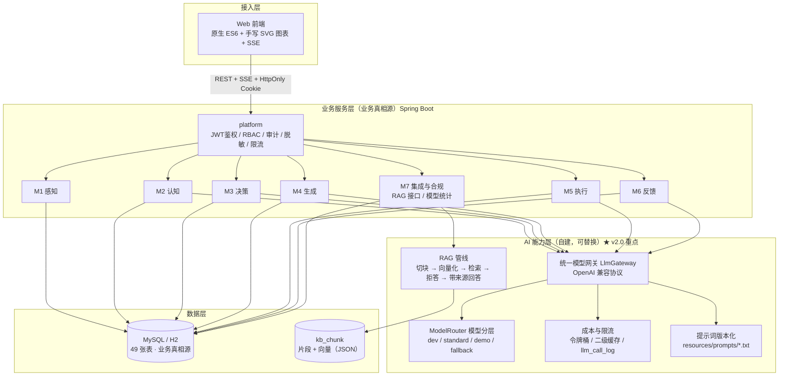
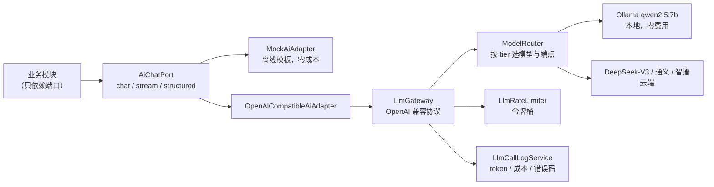
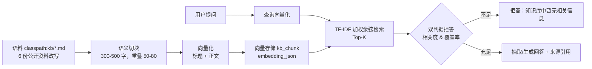

# 04 架构与 AI 伦理设计

> 课程交付物：技术架构与 AI 伦理设计说明（对应 v2.0 §5.6）
> 上游依据：`02a-需求分析与实施规划（上游基线）.md` v2.0
> 本文档描述的是**本项目实际实现的架构**，与代码一一对应，不含未落地的设想。

---

## 一、为什么是「自包含三层」

v2.0 移除了全部竞赛平台强制要求，工程重心从「平台适配」转回「AI 能力自建 + 业务闭环完整」。
因此架构必须自己承担原本由平台提供的三件事：**模型调用、RAG 检索、成本与限流治理**。



### 分层职责（**评审按此表打回 PR**）

| 层 | 必须做 | 禁止做 |
|---|---|---|
| 接入层 | 展示、表单校验、图表渲染 | 实现业务规则；在端上算分值 |
| 业务服务层 | 领域规则、事务、状态机、持久化 | 直接拼模型 HTTP 请求（必须走 `AiChatPort` / `LlmGateway`） |
| AI 能力层 | 厂商差异屏蔽、结构化契约、RAG、成本与限流 | 把原始厂商结构泄漏到领域对象；绕开限流直连模型 |
| 数据层 | 持久化、索引、DDL 迁移 | 把业务真相只存在模型上下文里 |

> **反模式警告**：不要把业务状态放进提示词当作唯一存储。模型是无状态算力，不是数据库。
> 所有持久化只走 MySQL/H2。

---

## 二、统一模型网关（FR-7.1，v2.0 核心新增）

### 2.1 为什么必须有一个网关

失去平台托管后，直接调厂商 SDK 会同时带来三个问题：换模型要改业务代码、成本无法集中统计、
限流无法统一防护。网关是同时解决这三件事的唯一干净做法。



### 2.2 关键实现

| 能力 | 实现 | 代码位置 |
|---|---|---|
| 屏蔽厂商差异 | 一个 OpenAI 兼容适配器覆盖 DeepSeek / 通义 / 智谱 / Ollama，差异只在 `base-url + model` | `ai/gateway/OpenAiCompatibleGateway` |
| 模型分层 | `dev`（Ollama）/ `standard`（DeepSeek）/ `demo` / `fallback`，配置在 `sys_config` 可改 | `ai/gateway/ModelRouter` |
| 换模型不改代码 | 只改 `a02.ai.provider` 与 `a02.ai.tier` | `application.yml` |
| 失败自动降级 | 真实通道异常 → 本地 Mock，响应标记 `degraded=true` | `AiService` |
| 结构化输出 | JSON 抽取 → 本地修复 → Schema 校验 → 业务规则校验 → **有界重试** → 兜底模板 | `ai/schema/*`、`AbstractStructuredAiAdapter` |

> **离线可用性**：没有 API Key、没有网络时，`provider=mock` 走本地规则模板，
> 输出与真实 Schema 同构，因此前端联调、单测、CI 全部可跑。

---

## 三、自建 RAG 管线（FR-7.2，v2.0 升级为 P0）

### 3.1 完整链路



### 3.2 五个工程决策（都是实测调出来的）

| 决策 | 原因 | 不这样做会怎样 |
|---|---|---|
| **切块用语义边界**（段落/句子累积 + 重叠） | 中文按固定字数硬切会把「指标体系的三个层级」切散 | 检索命中后拼出来的上下文读不懂 |
| **向量文本 = 文档标题 + 正文（剔除标题行）** | 同文档片段需要共享文档级语义；片段内标题行与问题字面高度重合但不含答案 | 只有「岗位职责」的片段会排到「MySQL/SQL」片段前面 |
| **TF-IDF 加权而非纯 TF 余弦** | 中文二元组普遍重叠，纯 TF 会让不相关文档也拿到 0.24 | 拒答阈值失效，什么都敢答 |
| **双判据拒答**（余弦相关度 + 实词覆盖率） | 单靠余弦无法拒绝跑题问题 | 问「2027 高考分数线」也会强行作答 |
| **抽取式回答兜底** | 离线模式没有可靠生成能力 | 模型自由发挥 → 幻觉，且无法追溯 |

### 3.3 实测效果（52 条评测集）

| 指标 | 实测 | v2.0 目标 |
|---|---|---|
| Recall@5 | **100%** | ≥80% |
| Recall@1 | 63.5% | — |
| MRR | 0.783 | — |
| 关键词命中率 | 98.1% | — |
| 拒答（跑题问题） | 正确拒答，覆盖率 0 | 无来源不回答 |
| 检索延迟 | <10 ms（12 个片段） | — |

> **诚实说明**：Recall@5 在只有 6 篇文档、Top-5 的条件下必然偏高（随机也有约 83%），
> 因此同时报告 **Recall@1 与 MRR** 这两个更严格的指标。
> 向量化默认使用**本地确定性 hashing 向量**（离线可用），它捕捉字面相似度而非语义泛化；
> 配置 `a02.ai.embedding.provider=openai` 可切云端 embedding，接口不变。

### 3.4 迁移路径

业务只依赖 `VectorStore` 接口。当前实现是 `JdbcVectorStore`（向量存 `kb_chunk.embedding_json`，
内存余弦检索），适合数千级片段。数据量上万后可新增 Milvus / Redis Stack 实现，业务代码不动。

---

## 四、成本与限流（NFR-8，v2.0 重点）

### 4.1 四项必做措施与实现

| 措施 | 实现 | 代码位置 |
|---|---|---|
| ① 客户端令牌桶 | 全局限 22 RPM（供应商 30 RPM 的 73%），单用户 8 RPM，日上限 1500 次 | `platform/ratelimit/LlmRateLimiter` |
| ② 限流当退避信号 | 错误码区分 `RATE_LIMITED` 与 `TIMEOUT`/`UPSTREAM_UNAVAILABLE`；**限流不做即时重试** | `ai/gateway/LlmException` |
| ③ 减少调用次数 | 结构化结果二级缓存（场景 + 上下文指纹，TTL 600s）；单次结构化代替多轮扇出 | `AiService` |
| ④ 优雅降级 | 限流时返回兜底模板/缓存结果并标记 `degraded`，**不向前端抛错** | `AiService.structured/chat` |

### 4.2 成本记账

每次调用写 `llm_call_log`：场景、模型、提示词版本、token（估算）、耗时、错误码、
缓存命中、是否降级、估算成本、traceId。管理端 `GET /api/admin/llm-stats` 与
界面「模型与成本」面板展示：日调用量、失败率、缓存命中率、按功能消耗、按供应商消耗。

> **token 为估算值**（中文约 1 字 ≈ 0.7 token），仅用于预算控制与横向对比，不作为计费依据。

### 4.3 限流演练

`a02.ai.limit.apply-to-mock=true` 后，Mock 通道也参与限流；
连续调用超过阈值时接口仍返回 200，但响应标记 `degraded=true`，
前端展示「已降级」提示 —— 这就是 v2.0 要求的「限流时降级而非报错」。

---

## 五、数据架构

### 5.1 数据主权

| 数据类别 | 存放 | 理由 |
|---|---|---|
| 用户、画像版本、路径、任务、评分、日志 | **MySQL/H2（唯一真相源）** | 需要关系查询、事务、审计 |
| 知识库片段与向量 | `kb_chunk`（本项目自有） | 自主可控，无外部依赖 |
| 模型调用记录 | `llm_call_log` | 成本统计、限流排查、责任追溯 |
| 模型上下文 | **不持久化** | 每次由后端注入，保证可替换与可复现 |

### 5.2 雷达图版本化（P1 难题的答案）

```
competency_radar: id, user_id, version(自增 per user), triggered_by,
                  formula_version, calc_input_json(可审计快照), created_at
radar_dimension_score: radar_id, dimension_key(8维), raw_score, weighted_score, source_detail_json
```

- **版本一旦生成即只读**，重算产生新版本 → 「两时点对比」退化为两个 radar_id 做差；
- `calc_input_json` 保存本次计算的全部输入与权重 → 任何历史版本都能复算与审计；
- 分值公式：`raw = Σ(来源分值×权重)/Σ(权重)`，`final = old×(1-α)+raw×α`，**AI 不参与打分**。

### 5.3 表规模

49 张表，按域分组：身份 6 / 画像 5 / 图谱 7 / 决策 5 / 生成 4 / 执行 7 / 反馈 4 /
平台 7 / **RAG 与模型成本 4（v2.0 新增：kb_chunk、kb_retrieval_log、kb_eval_case、llm_call_log）**。

---

## 六、AI 伦理设计（课程硬要求，独立成章）

### 6.1 六个维度与代码落点

| 维度 | 风险 | 本项目措施 | 可验证证据 |
|---|---|---|---|
| **算法偏见** | 推荐偏向热门岗位/特定性别专业 | ① 人设提示词显式禁止因性别、年龄、地域、院校层次给差异建议；② 管线**不把**这些属性作为输入（院校名在脱敏阶段泛化）；③ 雷达与匹配度由本地公式计算，AI 不参与 | `persona.txt`；`PiiRedactor` 单测；雷达公式单测 |
| **隐私保护** | 用户信息泄露、被第三方模型留存 | ① 最小必要采集（不采身份证/银行卡）；② 手机号/邮箱 AES-GCM 加密列；③ 传模型前脱敏（姓名→用户A、手机→掩码、院校→泛化）；④ 数据导出与级联删除；⑤ 开发期默认走本地 Mock/Ollama，敏感数据不出内网 | `FieldEncryptor`、`PiiRedactor`、`DataErasureService` 及其单测 |
| **防过度依赖** | 用户盲从 AI 建议 | ① RAG 上下文不足时**拒答**；② 关键建议附来源引用；③ 界面固定「AI 生成，仅供参考」；④ 提示词拒绝医疗/法律等专业决断 | RAG 拒答实测；`disclaimer` 字段 |
| **透明性** | 用户不知在与 AI 对话 | ① 所有 AI 消息标记 `is_ai_generated`；② 界面固定 AI 标识；③ 对话页展示「注入给模型的结构化上下文」；④ 模型与成本面板公开调用量 | `chat_message.is_ai_generated`；平台页 |
| **责任归属** | 错误建议造成损失 | ① AI 产出必须过 Schema 与业务规则双校验才落库；② `llm_call_log` 记录模型/提示词版本/token/错误码，可追溯；③ 明确免责声明 | `ai_generation_log` → `llm_call_log`；`AiService` |
| **合规** | 第三方数据侵权 | ① 仅公开资料改写 + 自构造模拟数据；② 开源组件标注来源与协议；③ 不爬取简历库 | `docs/开源组件清单.md`、`kb/*.md` 来源标注 |

### 6.2 架构级伦理主张（答辩金句）

> **AI 的输出永远不直接写业务真相源，必须先过校验与审计。**
> 这不是流程要求，是代码结构保证的：`ai-adapter` 返回的是领域对象，
> 落库发生在业务模块内并带校验；限流与降级同样不会污染业务状态。

### 6.3 与 v1.0 的差异

v1.0 的伦理措施依赖「平台侧不训练、不过滤」的承诺；v2.0 失去平台兜底后，
**隐私与伦理责任完全由本项目承担**，因此新增了三条硬约束：

1. **数据不出内网优先**：开发期默认本地 Mock / Ollama；
2. **RAG 拒答机制**：没有依据就不回答，而不是让模型自由发挥；
3. **成本与调用全量留痕**：`llm_call_log` 让「谁、在什么场景、用了什么模型」可追溯。

---

## 七、与课程五个实验的映射

| 实验 | 本架构中的物证 |
|---|---|
| 实验一 Spring Boot / CRUD / 分层 | `m1perception`：Controller → Service → Mapper（MyBatis + XML）→ Entity |
| 实验二 前后端分离 / RESTful / 跨域 | 86 个 REST 端点 + 统一响应体 + CORS 配置 + SSE 流式 |
| 实验三 Git / CI | `.github/workflows/ci.yml`（后端 / 接口契约 / 前端 / MCP 四个 Job）+ PR 模板 |
| 实验四 登录 / 权限 / AI 安全 | `platform/security`（JWT + RBAC + HttpOnly Cookie）+ 提示注入三层闸门 |
| 实验五 LLM / RAG / 原型 | `ai/gateway`（模型网关）+ `ai/rag`（自建 RAG）+ 6 类 AI 场景 |

---

## 八、已知限制（如实说明）

| 限制 | 原因 | 影响与应对 |
|---|---|---|
| 前端未用 Vue 3 | 开发机离线，npm 源不可达 | 用原生 ES6 + 手写 SVG 实现；接口契约不变，联网后可 1:1 替换 |
| 数据库默认 H2 内存库 | 无 Docker，零配置演示优先 | 提供 MySQL profile；DDL 兼容 MySQL 8 |
| 向量化默认本地 hashing 向量 | 无 GPU、无法下载 bge-m3 | 捕捉字面相似度；可切云端 embedding；评测已给量化指标 |
| 未做正式压测 | 无 JMeter/wrk | `llm_call_log` 已记录耗时，可作基线；文档不宣称达标 |
| 未连接真实模型 | 无 API Key | 网关与适配器已实现，配置即用；`mock` 通道保证演示可跑 |
